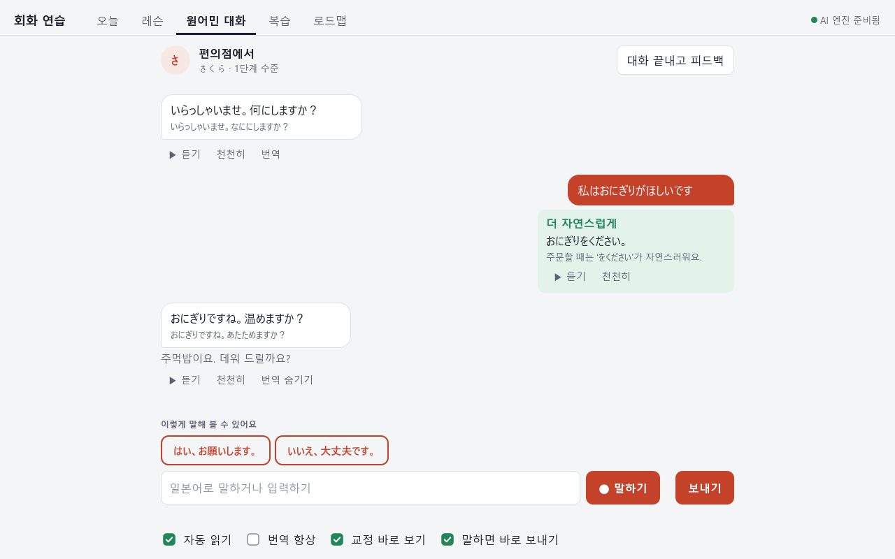
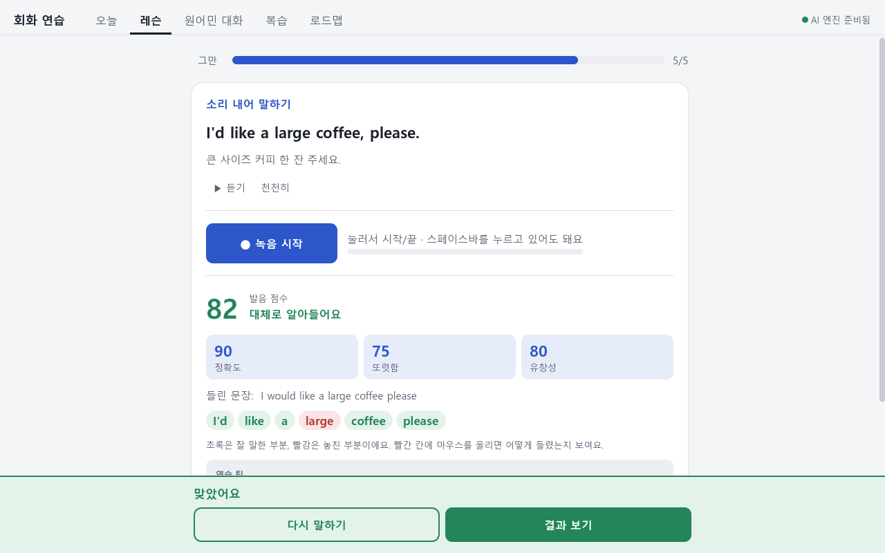

# 회화 연습 프로그램 (영어·일본어)

한국어 사용자를 위한 Windows용(안드로이드 폰에서도 PC에 연결해 쓰거나, 1.3부터는 PC 없이 폰만으로도 사용 가능) 영어·일본어 말하기 연습 프로그램입니다. 1년 커리큘럼을 따라 매일 레슨을 풀고, AI 원어민과 대화하고, 내 발음을 녹음해 채점받습니다. 음성 인식·목소리·발음 채점은 내 PC 안에서 돌아가고 비용이 들지 않습니다.

- **다운로드:** https://github.com/Whahan/hoehwa-practice/releases/latest
- **저장소:** https://github.com/Whahan/hoehwa-practice
- **설치 가이드 (PC·안드로이드·Tailscale 연결):** [INSTALL.md](INSTALL.md)
- **PC 설치는 파일 하나:** `hoehwa-practice-setup.exe`를 받아 더블클릭하면 끝입니다(질문 없음). 아래 "설치/업데이트"를 보세요.

## 할 수 있는 것

| 기능 | 내용 |
|---|---|
| 홈 | 선택한 언어(영어/일본어) 하나의 **오늘 할 일**(레슨·복습·노래 외우기), **이어하기**(마지막에 하던 것), **연속 학습일**과 보호권. 앱을 켜면 맨 먼저 나오는 화면입니다 |
| 레슨 | **진도 길**: 12개월 x 4주 = 48칸. 지금 칸과 앞 2칸까지 바로 열리고, 더 먼 칸은 "미리 해 볼까요?" 확인 뒤에 열립니다. 한 칸에서 실제 예문(Tatoeba)으로 매번 새로 만드는 문제 10개(고르기, 빈칸, 문장 조립, 듣기, 따라 말하기)를 풀고, 정답이 틀릴 일이 없고 바로 만들어집니다. AI 레슨도 선택 가능 |
| 원어민 대화 | 카페 점원, 편의점 직원 같은 역할을 맡은 AI와 말로 대화. 틀린 문장은 몇 초 뒤 초록색 상자로 고쳐 주고, 끝나면 피드백 |
| 발음 채점 | 녹음한 내 목소리를 정확도·또렷함·유창성으로 채점. 영어는 억양 그래프(원어민과 내 높낮이 비교)와 소리 단위(음소) 교정까지 |
| 읽기 | 글을 붙여 넣으면 어려운 단어를 색으로 표시. 누르면 뜻·발음·실제 예문, 복습 목록에 바로 추가 |
| 복습 | 잊어버릴 때쯤 다시 나오는 간격 반복(FSRS). 레슨에서 틀린 문장, 대화에서 고친 문장(자동으로 카드가 됩니다), 읽기에서 모은 단어가 쌓입니다 |
| 연습: 미션 | 카페 주문, 호텔 체크인, 길 묻기, 면접 같은 상황 미션 8개(영어). AI 상대와 대화하며 목표를 하나씩 채우고 별을 받습니다. 목표 확인은 규칙으로 바로 하고, 놓친 목표만 AI에게 한 번 더 물어볼 수 있습니다 |
| 연습: 쉐도잉 | 문장을 들려주고 따라 말하면 단어별로 채점합니다(영어·일본어). 같은 문장을 반복하거나 다음 문장으로 넘어갑니다 |
| 연습: 받아쓰기 | 문장을 듣고 쓰면 틀린 단어를 표시합니다(영어) |
| 연습: 약한 소리 | 발음 채점이 쌓은 기록에서 자주 틀리는 소리(예: th, r/l)를 찾아 낱말 쌍·짧은 문장으로 집중 연습합니다(영어) |
| 기록 | 하루 공부 목표(기본 10분)와 달성 표시, 연속 공부 기록(하루 빠져도 보호권으로 이어 줌), 공부 시간·레슨 정답률·발음 점수 추이 그래프 |
| 로드맵 | 12개월 커리큘럼과 월별 체크리스트 |
| 노래 | 내 음악 파일과 가사로 공부하기·가사 외우기. 곡 제목만 적어 가사를 찾을 수도 있습니다(아래) |

**화면 구성(1.5):** 폰에서는 아래 탭이 **홈 · 레슨 · 복습 · 노래 · 메뉴** 5개이고, 대화·연습·읽기는 홈의 바로가기 줄에, 기록·로드맵·설정은 "메뉴" 화면에 있습니다. PC에서는 왼쪽 메뉴가 3묶음입니다: **공부**(홈·레슨·복습·노래), **말하기·읽기**(원어민 대화·연습·읽기), **기록**(기록·로드맵). 설정은 맨 아래에 있습니다.

## 노래로 공부하기 · 가사 외우기

내가 가진 음악 파일과 가사로 공부합니다. 가사는 직접 붙여 넣거나, 원하면 제목으로 LRCLIB에서 찾아 받아 옵니다.

- **제목으로 가사 찾기(1.4.1):** 노래 화면 맨 위 "제목으로 가사 찾기" 카드에 곡 제목(가수도 적으면 더 정확합니다)을 적고 [찾기]를 누르면 LRCLIB에서 후보를 보여 줍니다(최대 10개). 후보를 누르면 가사 앞부분을 미리 보고, [이 가사로 외우기]로 저장합니다. PC가 없어도 됩니다. 결과가 없으면 PC에 연결했을 때 [AI로 다시 찾기]가 나와 적은 말을 원래 제목·가수로 바꿔 다시 찾고(AI는 제목 후보만 만들고 가사는 쓰지 않습니다), 그래도 없으면 [가사 붙여넣기]로 직접 넣습니다.

- **노래로 공부하기:** 내 음악 파일(mp3 등)과 가사를 한 곡으로 등록하면 줄 반복, 따라 부르기, 단어 보기, 빈칸 채우기, 받아쓰기, 해석을 할 수 있습니다. 곡을 새로 등록할 때(받아 적기·시간 맞추기)는 PC 연결이 필요하고, 등록한 곡은 PC 없이도 공부할 수 있습니다.
- **가사만으로 외우기:** 음악 없이 가사 글자만으로 외웁니다. 줄 글자를 점점 가려 가며 입력하거나 말하기로 확인하고, 줄 단위로 복습 시기를 정해 줍니다. 가사 등록·외우기·입력 채점·복습은 PC 없이 폰만으로도 됩니다. 말하기 자동 채점과 해석 만들기는 PC에 연결했을 때만 되고, PC가 없으면 말하기는 스스로 "잘했어요/다시"로 평가합니다.

**저작권과 개인정보 안내**

- 가사·음원은 앱에 들어 있지 않습니다(설치 파일에도 없습니다). 저장소에는 시험용으로 직접 쓴 짧은 문장과 합성 소리만 있고, 실제 노래 가사·음원은 없습니다.
- 내가 가진 파일과 내가 넣은 가사만 씁니다. 개인 학습용으로만 쓰세요.
- 곡과 가사는 이 기기에만 저장됩니다. 동기화·백업·배포에 들어가지 않고, 다른 곳에 올리거나 공유하는 기능도 없습니다.
- 온라인 가사는 LRCLIB(lrclib.net)에서 내가 "찾기"를 누를 때만 받아 옵니다. 이때 곡 제목·가수(곡을 등록할 때는 길이도)가 lrclib.net으로 나가고, 받은 곡에는 출처(LRCLIB)가 표시됩니다. 가사의 저작권은 각 권리자에게 있습니다.
- "AI로 다시 찾기"를 쓰면 내가 적은 제목 말이 AI 서비스(무료 DeepSeek, OpenCode 경유)로 보내집니다. 가사는 보내지 않습니다. 처음 쓸 때 동의를 받습니다.
- 해석을 만들 때는 가사가 같은 AI 서비스로 보내질 수 있습니다. 처음 쓸 때 동의를 받고, 곡마다 끌 수 있습니다. 로컬 AI는 더 이상 없으므로, 가사가 내 기기 밖으로 나가는 것이 싫으면 해석 만들기를 끄세요(그 밖의 노래 기능은 AI 없이 됩니다).
- AI 연결에 쓰는 OpenCode 키는 이 PC의 OpenCode에만 저장됩니다. 이 앱과 백엔드는 키를 저장하거나 로그·설정 파일에 기록하지 않습니다(자세한 것은 아래 "AI 연결하기").

## 필요한 것

- Windows 10/11 64비트
- 디스크: 설치가 끝난 뒤 약 4~7GB(NVIDIA 그래픽카드가 없으면 더 작습니다). 설치하는 동안에는 설치 드라이브에 여유 10GB(NVIDIA가 있으면 14GB) 이상, 임시 폴더 드라이브에 3GB 이상이 필요합니다.
- 인터넷: 설치할 때 약 4~6GB를 받습니다(보통 10~15분, 인터넷 속도에 따라). 설치한 뒤에는 AI(무료 DeepSeek)를 쓸 때만 필요합니다.
- 마이크
- NVIDIA 그래픽카드: 선택입니다. 없어도 되고, 있으면 음성 인식이 빠릅니다. 없으면 GPU 전용 라이브러리(약 2GB)는 설치하지 않고 음성 인식이 CPU로 동작합니다.
- 설치 용량과 시간은 NVIDIA 그래픽카드 유무와 인터넷 속도에 따라 달라집니다(위 숫자는 설계 때의 추정치입니다).

## 설치/업데이트

**처음 설치 (한 번만): 파일 하나, 질문 없음**

1. https://github.com/Whahan/hoehwa-practice/releases/latest 에서 `hoehwa-practice-setup.exe`를 받습니다.
2. 받은 파일을 **더블클릭**합니다. 질문 없이 진행 막대만 나옵니다. 관리자 권한 확인 창도 뜨지 않습니다(내 계정 폴더에 설치).
3. 끝날 때까지 기다립니다(10~15분). 끝나면 앱이 저절로 켜지고, 바탕화면에 **회화 연습** 바로가기와 시작 메뉴의 "회화 연습" 폴더(앱 / 업데이트 / 제거)가 생깁니다.
4. 중간에 창을 닫거나 인터넷이 끊겨도, 같은 `hoehwa-practice-setup.exe`를 다시 실행하면 끝난 단계는 건너뛰고 이어서 합니다. 실패하면 한 줄 원인과 `install.log` 위치가 나옵니다.

설치 위치는 `%LOCALAPPDATA%\Programs\회화연습`입니다(그 경로가 80자를 넘으면 `C:\회화연습`). 안에 파이썬 환경, 음성 모델, OpenCode(무료 AI 연결 프로그램), 문법 검사기용 자바(JRE)와 LanguageTool이 들어갑니다. 받는 것은 모두 공식 주소에서 받고 SHA256으로 확인합니다.

**Windows 경고가 나올 때**

이 프로그램은 코드 서명이 없어서 처음 받을 때 경고가 나올 수 있습니다.

> Windows가 "Windows의 PC 보호" 창을 띄우면 **[추가 정보]** 를 누른 뒤 **[실행]** 을 누르세요. 서명이 없는 새 프로그램이라 나오는 경고예요. 브라우저가 "흔히 다운로드되지 않는 파일"이라고 하면 **[유지]** 를 고르세요. 안심하려면 받은 파일의 해시를 릴리스의 `SHA256SUMS.txt` 와 비교하세요: `certutil -hashfile hoehwa-practice-setup.exe SHA256`

**설치 폴더 바꾸기 (선택)**

화면에서는 묻지 않습니다. 바꾸고 싶으면 명령 프롬프트나 PowerShell에서 인자로 줍니다: `hoehwa-practice-setup.exe /DIR="D:\회화연습"`. **빈 폴더이거나 새 폴더만** 됩니다. 다른 파일이 든 폴더나 드라이브 맨 위(`D:\`)는 설치 전에 거절합니다(제거할 때 폴더를 통째로 지우기 때문입니다). 폴더 경로는 짧게 해 주세요(95자를 넘으면 설치가 멈춥니다).

**AI 연결하기 (한 번만, PC에서만)**

설치 중에는 로그인하지 않습니다. 대화·AI 레슨·AI 교정처럼 AI가 필요한 기능을 처음 누르면 [AI 연결하기] 창이 한 번 열립니다(위쪽 안내줄, 홈의 안내 카드, 설정 > 엔진 > AI 연결에서도 언제든 열 수 있습니다).

1. [OpenCode 열기]를 눌러 브라우저에서 OpenCode(https://opencode.ai/auth)에 로그인하고 **API 키를 복사**합니다.
2. 앱의 키 칸(입력한 글자가 가려집니다)에 붙여 넣고 [연결]을 누릅니다. 몇 초 뒤 "AI가 연결됐어요."가 나옵니다.

연결하기 전에도 레슨, 받아쓰기, 쉐도잉, 발음 채점, 복습, 노래 외우기, 문법 검사처럼 AI가 필요 없는 기능은 그대로 됩니다. AI는 무료 DeepSeek V4.1 Flash(OpenCode) 하나뿐이고, 무료 제공 여부는 OpenCode 쪽 사정에 따라 달라질 수 있습니다(한도에 걸리면 안내만 나오고 다른 AI로 바뀌지는 않습니다). 연결 상태 확인·시험·해제는 설정 > "AI 연결" 카드에서 합니다. 해제하면 이 PC의 OpenCode 로그인이 지워져서 터미널에서 쓰던 OpenCode도 로그아웃됩니다. 폰에서는 연결 창을 열지 않고, "PC의 회화 연습 설정에서 'AI 연결하기'를 눌러 주세요"라고만 안내합니다.

**키와 개인정보:** 키는 이 PC의 OpenCode에만 저장됩니다. 이 앱과 백엔드는 키를 저장하거나 로그·설정 파일에 기록하지 않고, 키는 이 PC 안에서만 OpenCode에 전달됩니다(같은 PC의 앱에서만 연결할 수 있고, 폰에서 PC로는 열려 있지 않습니다). 대화·레슨 내용은 AI 서비스(DeepSeek, OpenCode 경유)로 전송됩니다.

**업데이트**

- 시작 메뉴의 "회화 연습 업데이트"(또는 설치 폴더의 `업데이트.bat`)를 더블클릭합니다. GitHub의 최신 릴리스와 비교해서 새 버전이 있으면 받아서 적용하고, 최신이면 "최신 버전입니다"라고 알려 줍니다. 새 `hoehwa-practice-setup.exe`를 받아 같은 곳에 다시 실행해도 됩니다.
- 바뀐 파일만 바꾸고, 파이썬 패키지·음성 모델도 바뀐 것만 받습니다. 학습 기록, 설정, AI 연결(OpenCode 로그인)은 그대로 남습니다.
- 바꾸기 전 파일은 `backup\<이전 버전>\`에 보관되고, 업데이트 중 문제가 생기면 자동으로 이전 버전으로 되돌립니다.
- 앱 폴더가 커지지 않게 정리합니다: 백업은 직전 것 하나만 남기고, 받은 업데이트 파일·임시 폴더는 성공/실패와 상관없이 바로 지우고, pip 캐시는 쓰지 않고, 새 버전에 필요 없어진 음성 모델 파일도 지웁니다. 끝에 `업데이트 전 X GB → 후 Y GB`를 보여 줍니다.

**1.4.x(zip으로 설치한 옛 버전)를 쓰고 있다면**

- 그대로 `업데이트.bat`으로 1.5.0까지 올라가며 계속 쓸 수 있습니다. 옛 OpenCode 로그인도 그대로라서 다시 로그인하지 않아도 됩니다. 새로 설치할 필요가 없습니다.
- 새 `hoehwa-practice-setup.exe`는 **새 폴더에 따로 설치**됩니다(옛 폴더와 합쳐지지 않아, 둘 다 두면 용량을 두 배로 씁니다). 학습 기록은 같은 곳(`%APPDATA%\Godotpp_userdata\회화 연습`)을 쓰므로 이어집니다. 옛 폴더는 안의 `제거.bat`으로 지울 수 있습니다.
- **오프라인 로컬 AI(Ollama)는 1.5.0부터 없어졌습니다.** 옛 설정이 로컬 AI였다면 처음 켤 때 무료 DeepSeek로 바뀌고 한 번 안내가 나옵니다. 이전에 설치해 둔 Ollama는 지우지 않으니, 안 쓰면 Windows 설정 > 앱에서 지워 약 5GB를 비울 수 있습니다.

**제거**

- Windows 설정 > 앱에서 "회화 연습"을 제거하거나, 시작 메뉴의 "회화 연습 제거"를 실행합니다. 설치 폴더가 통째로 지워집니다.
- **학습 기록은 남습니다**(`%APPDATA%\Godotpp_userdata\회화 연습`). OpenCode 로그인도 지우지 않습니다. 기록까지 지우려면 그 폴더를 직접 지우세요.

릴리스 만들기(개발자): `packaging\get_build_tools.ps1`로 Inno Setup 6.7.4(해시 고정)를 받아 둔 뒤 `packaging\publish_release.ps1 -Version 1.2.3 -Notes "바뀐 점"` — `hoehwa-practice-setup.exe`, 업데이트 zip(`hoehwa-practice-update-<버전>.zip`), `SHA256SUMS.txt`, `latest.json`을 만들어 GitHub 릴리스에 올립니다. 먼저 `-DryRun`으로 확인하세요. 배포 저장소는 `packaging
elease.json`에 있습니다.

내 PC에서 돌아가는 회화 연습 프로그램입니다. 비용이 들지 않습니다. 음성 인식·목소리·발음 채점·문법 검사는 인터넷 없이 동작하고, 대화·레슨 AI는 무료 DeepSeek V4.1 Flash(OpenCode, 인터넷 필요)를 씁니다.

## 휴대폰에서 쓰기 (안드로이드)

안드로이드 폰에서 홈·레슨·대화·읽기·복습·노래·로드맵을 쓸 수 있습니다(아래 탭: 홈·레슨·복습·노래·메뉴). PC와 연결하면 음성 인식·목소리·채점·AI는 **내 PC**가 하고, 폰은 화면과 마이크만 맡습니다(이때는 PC 앱이 켜져 있어야 합니다). **PC 없이 폰만으로 쓰기(1.3부터):** 연결 화면의 "PC 없이 시작"을 누르면 레슨·복습·받아쓰기·쉐도잉 문장 듣기(폰에 설치된 음성)·미션 대본·영어 읽기와 단어 뜻·예문·히라가나/가타카나 익히기·제목으로 가사 찾기를 폰 안에서 합니다. 말하기는 "내 목소리 듣기 / 원어민 듣기" 뒤 스스로 "잘했어요 / 다시"로 평가합니다. 발음 채점·AI 대화·억양·음소 분석·일본어 읽기 분석은 PC에 연결했을 때만 됩니다. AI 연결(OpenCode 키 붙여 넣기)은 PC에서만 하고, 폰에는 연결 창이 없습니다. 자세한 것은 [INSTALL.md](INSTALL.md) 5절에 있습니다. **연결은 Tailscale로만 합니다**(같은 와이파이나 USB 테더링 같은 사설 네트워크로는 연결되지 않고, PC를 자동으로 찾아 주는 기능도 없습니다). PC와 폰에 Tailscale을 설치하고 같은 구글 계정으로 로그인하면, 와이파이가 달라도(밖에서 모바일 데이터로도) 폰에서 이 PC의 회화 연습을 쓸 수 있고, 통신은 Tailscale이 암호화합니다. 폰 연결은 기본으로 꺼져 있고, 켜도 연결 코드를 입력한 폰만 쓸 수 있습니다. (PC 앱도 휴대폰 연결이 들어 있는 버전이어야 합니다. 폰 앱은 PC 앱과 같은 버전으로 나옵니다.)

**폰에 설치 (한 번만)**

1. 폰에서 https://github.com/Whahan/hoehwa-practice/releases/latest 를 열어 `hoehwa-practice-android-<버전>.apk` 를 받습니다.
2. 받은 파일을 열면 "출처를 알 수 없는 앱 설치"를 허용하라고 나옵니다. 사용 중인 브라우저(또는 파일 앱)에 대해 허용해 주세요. Google Play에 올린 앱이 아니라서 나오는 안내입니다.
3. Play Protect가 "안전하지 않은 앱" 경고를 띄우면 **무시하고 설치**(또는 "그래도 설치")를 고릅니다. 앱을 직접 서명했지만 Google이 모르는 개발자라서 나오는 경고입니다. 걱정되면 릴리스의 `SHA256SUMS.txt` 값과 받은 파일의 SHA-256이 같은지 확인하세요.
4. 처음 녹음할 때 마이크 권한을 묻습니다. "허용"을 누르세요. 거부했다면 폰 설정 > 앱 > 회화 연습 > 권한 > 마이크에서 켤 수 있습니다.

**PC와 연결 (Tailscale)**

1. **Tailscale 설치·로그인:** PC와 폰에 Tailscale 앱(tailscale.com)을 설치하고, 두 기기를 **같은 구글 계정**으로 로그인해 켜 둡니다. 개인용 무료 요금제가 있습니다(조건은 공식 사이트에서 확인하세요).
2. PC에서 회화 연습을 켜고 **설정 > 휴대폰 연결**을 켭니다. Tailscale 주소(`100.`으로 시작, 예: `100.101.102.103:8775`)와 6자리 연결 코드가 나옵니다(코드는 5분 동안만, 한 번만 쓸 수 있고 5번 틀리면 잠깁니다). PC에서 Tailscale이 꺼져 있거나 설치되지 않았으면 켜지지 않고 안내가 나옵니다.
3. 처음 켜면 Windows 방화벽이 통신 허용 여부를 물을 수 있습니다. 허용해 주세요. 앱이 방화벽 설정을 직접 바꾸지는 않습니다.
4. 폰 앱의 주소 칸에 PC 화면의 Tailscale 주소를 입력하고 연결 코드를 넣습니다. 한 번 연결하면 다음부터는 코드가 필요 없습니다.
5. 안 쓸 때는 PC의 설정에서 휴대폰 연결을 끄세요. 끄면 연결 포트가 바로 닫힙니다. PC 설정에서 폰 연결을 개별 해제하거나 모두 해제할 수도 있습니다.

**알아 둘 것**

- 같은 Tailscale 계정(테일넷)에 들어온 다른 기기도 이 PC의 연결 포트에 닿을 수 있습니다(연결 코드나 토큰이 있어야 쓸 수 있어요). 계정을 남과 공유하지 마세요.
- PC가 잠들거나 꺼지면 폰에서 쓸 수 없습니다.
- 학습 기록 동기화(1.2부터): 처음 연결할 때 "합칠까요 / 따로 쓸까요"를 한 번 묻습니다. 합치면 복습 카드·공부 시간·연속 기록·미션 기록이 폰과 PC에서 합쳐지고(합치기 전 자동 백업), 설정의 '학습 기록 동기화' 스위치로 언제든 끄고 켤 수 있습니다. 연결이 끊긴 동안 공부한 것은 다음 연결 때 반영됩니다. 보호권은 기기마다 따로입니다.
- **업데이트:** 새 APK를 받아 그대로 설치하면 기존 앱 위에 덮어 설치됩니다(학습 기록이 남습니다). 덮어 설치가 되려면 같은 키로 서명된 APK여야 합니다. 아래 개발자 절의 키스토어 경고를 꼭 읽어 주세요.
- 폰에서 안 잡힐 때 점검: ① PC 앱의 '휴대폰 연결'이 켜져 있는지 ② PC와 폰 모두 Tailscale이 켜져 있고 같은 계정인지 ③ 입력한 주소가 PC 화면에 나온 Tailscale 주소(100.x.y.z)인지 ④ Windows 방화벽 허용 창을 눌렀는지.

## 실행

시작 메뉴의 "회화 연습"이나 바탕화면의 **회화 연습** 바로가기(설치 폴더의 `회화연습.exe`)를 더블클릭합니다.

- 처음 켜면 "AI 엔진 준비 중…" 화면이 나오고, 보통 15초~1분 정도 걸립니다. 음성 인식, 목소리, 문법 검사기를 불러오는 시간입니다.
- AI를 아직 연결하지 않았다면 홈에 "AI 연결하기" 안내가 나옵니다. 막지는 않으니 AI가 필요 없는 기능부터 써도 됩니다.
- 프로그램을 닫으면 프로그램이 직접 켠 음성·AI 서버도 같이 꺼집니다.
- 설치 폴더를 다른 곳으로 옮기지 마세요(exe는 바로 옆 폴더의 `backend`를 찾아서 씁니다). 옮겨야 하면 새로 설치하세요(학습 기록은 남습니다).
- 개발할 때는 `godot\` 프로젝트를 편집기에서 열어 F5로 실행하거나, 내보낸 `dist\회화연습.exe`를 씁니다.

## 화면 안내

위 "할 수 있는 것" 표의 화면이 이렇게 놓여 있습니다.

- **홈:** 위쪽 영어/일본어 스위치로 한 언어를 고릅니다. "오늘 할 일" 카드의 큰 시작 버튼이 오늘의 레슨을 엽니다. 그 아래 할 일 줄(레슨·복습·노래 외우기·선택으로 원어민과 말하기)이 하나씩 체크되고, "이어하기" 카드는 최근 7일 안에 하던 것이 있을 때만 나옵니다. "연속" 카드는 연속 학습일·보호권·XP를 보여 줍니다.
- **레슨:** 48칸 진도 길입니다. 칸을 누르면 그 주의 레슨 시트가 열립니다. 레슨을 5번 끝내거나 그 주 체크를 켜면 칸이 채워집니다.
- **복습 · 노래:** 복습할 카드가 있으면 아래 탭에 점이 붙습니다. 노래는 곡 목록과 위쪽 "제목으로 가사 찾기"가 있습니다.
- **메뉴(폰):** 대화·연습·읽기·기록·로드맵·설정이 한곳에 있습니다. PC는 왼쪽 메뉴에 같은 항목이 3묶음으로 있습니다.

공부 시간은 창에 포커스가 있고 최근 45초 안에 입력(또는 녹음·재생·서버 요청)이 있을 때만 셉니다. 학습 기록은 `studylog.json`에 따로 저장되며 기존 진행 기록(progress.json)은 건드리지 않습니다.

### 발음 채점은 이렇게 합니다

녹음한 목소리를 음성 인식(Whisper)이 직접 듣고, 목표 문장과 단어(일본어는 음절) 단위로 비교합니다.

- **정확도:** 목표 단어를 맞게 말했는지
- **또렷함:** 음성 인식이 그 단어를 얼마나 확신하며 알아들었는지
- **유창성:** 말하는 속도와 중간에 끊긴 시간
- 틀린 부분은 빨간색으로 표시하고, 한국인이 자주 틀리는 패턴을 찾아 한 줄 조언을 줍니다. 예: r/l, f/p, 장음, 촉음 っ

원어민 교사처럼 입 모양까지 보는 채점은 아니지만, 원어민이 알아들을 수 있게 말했는지는 꽤 정확하게 잡아냅니다.

## 문제가 생기면

| 증상 | 해결 |
|---|---|
| 설치가 중간에 멈춤·실패 | 같은 `hoehwa-practice-setup.exe`를 다시 실행하세요(끝난 단계는 건너뜁니다). 계속 안 되면 설치 폴더의 `install.log`를 확인하세요 |
| Windows가 "PC 보호" 창을 띄움 | [추가 정보] → [실행]. 위 "Windows 경고가 나올 때" 참고 |
| "AI 연결이 필요해요"가 나옴 | 처음 한 번 [AI 연결하기]로 OpenCode 키를 붙여 넣으세요. 설정 > 엔진 > AI 연결에서 다시 연결하거나 시험할 수 있습니다 |
| 키가 맞지 않다고 나옴 | OpenCode(opencode.ai/auth)에서 키를 다시 복사해 붙여 넣으세요. 공백이나 줄바꿈이 섞이지 않게 키만 복사하세요 |
| 한도에 걸렸다고 나옴 | 무료 DeepSeek의 한도·혼잡 안내입니다. 잠시 뒤 다시 시도하세요. 다른 AI로 자동 전환되지는 않습니다. AI 없이 되는 기능(레슨·복습·발음 채점·쉐도잉 등)은 그대로 쓸 수 있습니다 |
| 녹음이 조용하다고 나옴 | 윈도우 설정 → 개인 정보 → 마이크 → "데스크톱 앱이 마이크에 액세스하도록 허용"을 켜고, 프로그램 설정에서 마이크 장치를 고르세요 |
| 마이크를 열지 못했다고 나옴 | 녹음은 파이썬 서버(`pythonw`)가 맡습니다. 다른 프로그램이 마이크를 독점하고 있지 않은지 확인하고, 설정에서 다른 마이크를 골라 보세요 |
| AI 답이 이상함 | 무료 AI도 가끔 어색하거나 틀린 문제를 냅니다. AI 레슨은 정답을 한 번 더 검사해서 틀린 문제를 걸러 내지만 완벽하지는 않습니다. 정답이 보장되는 실제 예문 레슨을 쓰세요 |
| 서버만 따로 켜고 싶음 | `backend\run_backend.bat` (끄기: `backend\stop_backend.bat`) |

## 구성

| 폴더 | 내용 |
|---|---|
| `godot\` | 화면(Godot 4.6.3 프로젝트). 편집기에서 열고 F5로 실행할 수 있습니다 |
| `backend\` | 파이썬 로컬 서버: 음성 인식 Whisper small(GPU), 목소리 Kokoro(영어 af_heart, 일본어 jf_alpha), 발음 채점, 문법 검사(LanguageTool, `backend\tools`), AI 대화(무료 DeepSeek V4.1 Flash via `opencode serve`, 연결은 앱의 [AI 연결하기]) |
| `dist\` | 내보낸 exe (개발용) |
| `packaging\` | 설치 파일(setup.exe)·업데이트·릴리스를 만드는 스크립트 |
| `API.md` | 화면과 서버 사이의 API 규칙 |

개발 PC에서 파이썬 환경을 다시 만들려면 PowerShell에서 `backend\setup.ps1`을 실행합니다(설치 파일로 설치한 PC에서는 필요 없습니다).

## 개발자: 안드로이드 APK 만들기와 서명

- 필요한 것: Godot 4.6.3 안드로이드 export 템플릿(Godot 편집기 > 편집기 > 내보내기 템플릿 관리), JDK 17, Android SDK(platform-tools, build-tools 36.1.0, platforms android-36). 편집기 설정 > 내보내기 > Android 에 SDK·JDK 경로가 한 번 들어 있어야 합니다. Gradle·Android Studio는 필요 없습니다.
- **릴리스 키 만들기(딱 한 번):** `packaging\make_release_key.ps1` 은 `%LOCALAPPDATA%\hoehwa-practice\keys\` 에 `release.keystore` 와 무작위 비밀번호 파일 `release.pass` 를 만들고(이미 있으면 거부, 덮어쓰지 않습니다), 인증서 지문을 `packaging\android_cert.sha256` 에 적습니다. 그 지문 파일만 커밋하세요. 키 파일은 저장소 밖에만 두고, 저장소 안에 두면 빌드가 거부합니다.
- **빌드:** `packaging\build_android.ps1 -Version 1.1.0` 은 `godot\project.godot`·export preset의 버전과 맞는지 확인한 뒤 서명된 `packaging\out\android\hoehwa-practice-android-<버전>.apk` 를 만들고, 서명·패키지 이름(`io.github.whahan.hoehwa`)·versionCode·권한(INTERNET, ACCESS_NETWORK_STATE, RECORD_AUDIO뿐)·arm64-v8a만 들었는지 검사합니다. `-Debug` 는 시험 설치용 디버그 서명 APK(올리면 안 됩니다)입니다. 키스토어 비밀번호는 환경변수로 Godot 자식 프로세스에만 전달되며 `export_presets.cfg` 에는 쓰지 않습니다.
- **릴리스:** `packaging\publish_release.ps1 -Version 1.1.0 -WithApk -Notes "바뀐 점"` 은 설치 zip·업데이트 zip과 함께 APK를 `SHA256SUMS.txt` 에 넣어 올립니다. APK 서명 인증서가 `android_cert.sha256` 과 다르면 멈춥니다(`-AcceptNewKey` 로만 넘어갈 수 있고, 그러면 기존 사용자는 덮어 설치가 안 됩니다). 공개 전 검사(`-ScanOnly`)는 `.keystore` `.jks` `.p12` `.apk` `release.pass`, 키스토어 비밀번호가 적힌 줄이 추적되고 있으면 멈춥니다.
- **경고 — 키스토어를 잃어버리지 마세요.** 이 키스토어를 잃어버리거나 비밀번호를 잊으면 같은 앱을 덮어 설치할 수 없습니다. 사용자는 앱을 지우고 다시 설치해야 하고, 그러면 폰에 있던 학습 기록이 사라집니다. `keys` 폴더 전체를 서로 다른 두 곳(예: USB와 암호 관리자)에 백업하세요. 저장소에 올리지 마세요.

## 사용한 공개 자료와 라이선스

이 프로그램은 다음 공개 프로젝트와 자료를 사용합니다. 각 라이선스를 따릅니다.

| 이름 | 쓰는 곳 | 라이선스 |
|---|---|---|
| [Tatoeba](https://tatoeba.org) 예문 | 레슨·읽기 예문 | CC BY 2.0 FR (예문 화면에 출처 표시) |
| [Godot Engine](https://godotengine.org) | 화면 | MIT |
| [faster-whisper](https://github.com/SYSTRAN/faster-whisper) / Whisper | 음성 인식 | MIT |
| [Kokoro-82M](https://huggingface.co/hexgrad/Kokoro-82M) | 원어민 목소리 | Apache 2.0 |
| [wav2vec2 espeak](https://huggingface.co/facebook/wav2vec2-lv-60-espeak-cv-ft) | 음소 발음 채점 | Apache 2.0 |
| [LanguageTool](https://languagetool.org) | 문법 교정 (설치 때 내려받음) | LGPL 2.1 |
| [py-fsrs](https://github.com/open-spaced-repetition/py-fsrs) | 복습 주기 알고리즘 (GDScript로 옮김) | MIT |
| [pyopenjtalk](https://github.com/r9y9/pyopenjtalk), [spaCy](https://spacy.io) | 일본어 읽기, 단어 원형 | 각 프로젝트 라이선스 |
| [wordfreq](https://github.com/rspeer/wordfreq) 단어 빈도 데이터 | 단어 난이도·연습 문장 고르기 (폰 데이터 묶음에도 포함) | 코드 MIT, 데이터 CC BY-SA 4.0 |
| 폰용 단어 뜻 사전(영어 약 1만·일본어 약 5천 단어) | 폰 단독 모드의 단어 뜻 | 이 프로젝트가 로컬 AI(Qwen3 8B)로 만든 자료. 일부 뜻이 틀릴 수 있습니다 |
| [LRCLIB](https://lrclib.net) (lrclib.net) 가사 검색 | 노래 공부·가사 외우기의 "가사 찾기" (사용자가 누를 때만, 가사 저작권은 각 권리자에게 있고 개인 학습용으로만 사용) | 별도 데이터 라이선스 문구 없음 — 가사는 앱에 포함하지 않고 출처만 표시 |
| [OpenCode](https://opencode.ai) (DeepSeek V4.1 Flash 무료) | AI 엔진 (각 사용자 본인 계정·키, 설치 때 GitHub 릴리스에서 내려받음) | MIT / OpenCode 이용약관 |
| [Temurin JRE](https://adoptium.net) 21 | 문법 검사기(LanguageTool) 실행용 자바 (설치 때 내려받음) | GPL 2.0 + Classpath 예외 |
| [Inno Setup](https://jrsoftware.org/isinfo.php) 6.7.4 | 설치 파일(setup.exe)을 만드는 도구 (개발 PC에서만 씀, 앱에는 들어 있지 않음) | Inno Setup 라이선스 |

## 라이선스

이 프로그램의 코드는 [MIT 라이선스](LICENSE)입니다. 위 표의 공개 자료와 프로그램은 각자의 라이선스를 따릅니다.
