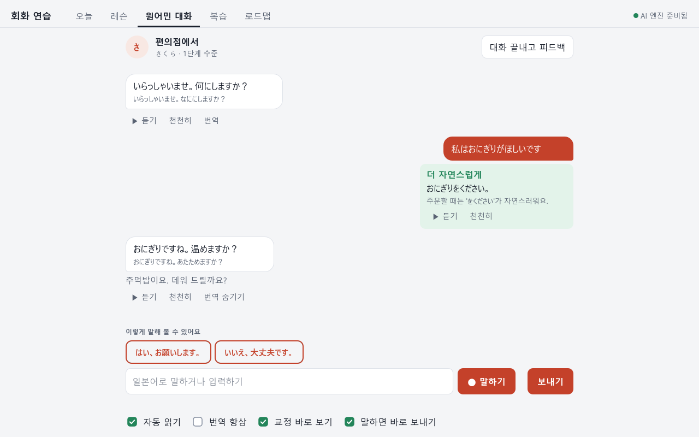
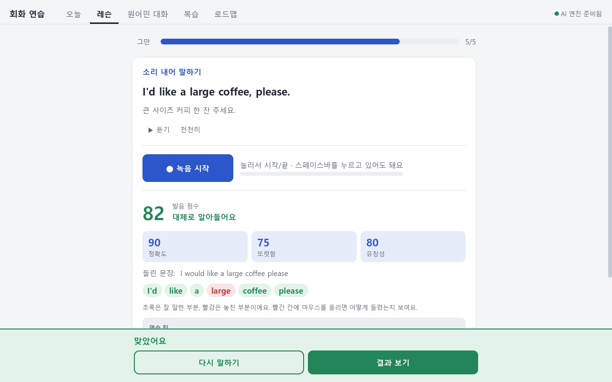

# 회화 연습 프로그램 (영어·일본어)

한국어 사용자를 위한 Windows용(안드로이드 폰에서도 PC에 연결해 쓰거나, 1.3부터는 PC 없이 폰만으로도 사용 가능) 영어·일본어 말하기 연습 프로그램입니다. 1년 커리큘럼을 따라 매일 레슨을 풀고, AI 원어민과 대화하고, 내 발음을 녹음해 채점받습니다. 음성 인식·목소리·발음 채점은 내 PC 안에서 돌아가고 비용이 들지 않습니다.

- **다운로드:** https://github.com/Whahan/hoehwa-practice/releases/latest
- **저장소:** https://github.com/Whahan/hoehwa-practice
- **설치 가이드 (PC·안드로이드·Tailscale 연결):** [INSTALL.md](INSTALL.md)
- **PC 설치는 파일 하나:** `hoehwa-practice-setup.exe`를 받아 더블클릭하면 끝입니다(질문 없음). 아래 "설치/업데이트"를 보세요.

## 할 수 있는 것

| 기능 | 내용 |
|---|---|
| 홈 | 선택한 언어(영어/일본어) 하나의 **오늘 할 일**(레슨·복습·노래 외우기), **이어하기**(마지막에 하던 것), **연속 학습일**과 보호권. 앱을 켜면 맨 먼저 나오는 화면입니다 |
| 레슨 | **진도 길**: 12개월 x 4주 = 48칸. 지금 칸과 앞 2칸까지 바로 열리고, 더 먼 칸은 "미리 해 볼까요?" 확인 뒤에 열립니다. 한 칸에서 실제 예문(Tatoeba)으로 매번 새로 만드는 문제 10개(고르기, 빈칸, 문장 조립, 듣기, 따라 말하기)를 풀고, 정답이 틀릴 일이 없고 바로 만들어집니다. AI 레슨도 선택 가능 |
| 원어민 대화 | 카페 점원, 편의점 직원 같은 역할을 맡은 AI와 말로 대화. 틀린 문장은 몇 초 뒤 초록색 상자로 고쳐 주고, 끝나면 피드백 |
| 발음 채점 | 녹음한 내 목소리를 정확도·또렷함·유창성으로 채점. 영어는 억양 그래프(원어민과 내 높낮이 비교)와 소리 단위(음소) 교정까지(PC). **2.0.1부터 폰만으로도 영어 말하기를 채점합니다("폰 간이 채점", 아래 "폰 안 음성 채점")** |
| 읽기 | 글을 붙여 넣으면 어려운 단어를 색으로 표시. 누르면 뜻·발음·실제 예문, 복습 목록에 바로 추가 |
| 복습 | 잊어버릴 때쯤 다시 나오는 간격 반복(FSRS). 레슨에서 틀린 문장, 대화에서 고친 문장(자동으로 카드가 됩니다), 읽기에서 모은 단어가 쌓입니다 |
| 연습: 미션 | 카페 주문, 호텔 체크인, 길 묻기, 면접 같은 상황 미션 8개(영어)와 **일본어 미션 8개**(1.7.0, 아래). AI 상대와 대화하며 목표를 하나씩 채우고 별을 받습니다. 목표 확인은 규칙으로 바로 하고, 놓친 목표만 AI에게 한 번 더 물어볼 수 있습니다 |
| 연습: 쉐도잉 | 문장을 들려주고 따라 말하면 단어별로 채점합니다(영어·일본어). 같은 문장을 반복하거나 다음 문장으로 넘어갑니다 |
| 연습: 받아쓰기 | 문장을 듣고 쓰면 틀린 곳을 표시합니다(영어·일본어). **일본어 받아쓰기**(1.7.0)는 아래에 있습니다 |
| 연습: 약한 소리 | 영어는 발음 채점이 쌓은 기록에서 자주 틀리는 소리(예: th, r/l)를 찾아 낱말 쌍·짧은 문장으로 집중 연습합니다. 일본어는 1.7.0부터 한국인이 자주 틀리는 소리 **6종**을 연습합니다(아래) |
| 연습: 가나 기초 코스 (1.6.0, 일본어) | 히라가나·가타카나를 **24단계**로 익힙니다(행별 11단계 x 2 + 헷갈리는 글자 단계 2개). 한 단계는 **15문제 중 12개**를 맞히면 통과합니다. 문제는 듣기·읽기·입력(소리를 로마자 `shi`나 한글 `시`로 직접 쓰기) 세 가지이고, 입력에서 모르면 [모르겠어요]로 넘어갑니다(틀림으로 셉니다). 헷갈리는 글자 **21쌍**(ぬ/め, シ/ツ 등)은 따로 골라 연습할 수 있습니다. 소리는 폰에 일본어 음성이 설치돼 있거나 PC에 연결돼 있을 때만 나고, 소리가 안 나는 기기에서는 듣기 문제가 읽기 문제로 바뀝니다. AI도 인터넷도 필요 없습니다 |
| 연습: 60초 스피드 퀴즈 (1.6.0) | 내 복습 카드와 레슨 단어의 뜻을 4지선다로 60초 안에 최대한 많이 고릅니다(영어·일본어). 맞힐수록 콤보가 쌓여 점수가 커지고, 최고 기록은 언어마다 따로 남습니다. 기록은 **5문제 이상** 푼 판부터 남습니다. 끝나면 틀린 단어를 [복습 카드로 추가]할 수 있습니다(누르기 전에는 복습 일정이 바뀌지 않습니다). AI·인터넷 없이 폰만으로 됩니다. 단어 뜻은 자동으로 만든 자료라 가끔 틀릴 수 있습니다 |
| 기록 | 하루 공부 목표(기본 10분)와 달성 표시, 연속 공부 기록(하루 빠져도 보호권으로 이어 줌), 공부 시간·레슨 정답률·발음 점수 추이 그래프. 맨 위에 **주간 리포트**(1.6.0): 지난 7일의 공부 시간·레슨 정답률·새 카드·발음 점수를 그 앞 7일(지난주)과 견줘 보여 줍니다 |
| 배지 (1.6.0, 1.7.0에서 25개) | 습관·레슨·말하기·노래·가나·스피드 여섯 분류의 **배지 25개**(1.6.0의 23개 + 1.7.0의 일기 배지 2개: 첫 일기 고침, 일기 7일). 메뉴의 "기록" 묶음에서 봅니다. 처음 켜면 지금까지의 기록으로 받을 수 있는 배지를 한꺼번에 받습니다. 한 번 받은 배지는 사라지지 않습니다(설정의 "모든 기록 지우기"만 예외입니다) |
| 연습: 한 줄 일기 (1.7.0) | 목표 언어(영어·일본어)로 1~3문장을 쓰면 AI가 고쳐 주고, 고친 문장만 복습 카드가 됩니다. 연습 허브의 7번째 카드와 홈 "이번 주" 카드의 [일기] 버튼에서 엽니다. 자세한 것은 아래 "한 줄 일기" 절 |
| 로드맵 | 12개월 커리큘럼과 월별 체크리스트 |
| 노래 | 내 음악 파일과 가사로 공부하기·가사 외우기. 곡 제목만 적어 가사를 찾을 수도 있습니다(아래) |

**화면 구성(1.5):** 폰에서는 아래 탭이 **홈 · 레슨 · 복습 · 노래 · 메뉴** 5개이고, 대화·연습·읽기는 홈의 바로가기 줄에, 기록·로드맵·설정은 "메뉴" 화면에 있습니다. PC에서는 왼쪽 메뉴가 3묶음입니다: **공부**(홈·레슨·복습·노래), **말하기·읽기**(원어민 대화·연습·읽기), **기록**(기록·로드맵). 설정은 맨 아래에 있습니다.

**1.6.0에서 더해진 것:** "기록" 묶음(폰은 메뉴 화면)에 **배지** 항목이 생겼고, 연습 허브에 **가나 기초 코스**와 **60초 스피드 퀴즈** 카드가 더해졌습니다. 홈에는 **"이번 주"** 카드가 생겼습니다(아래 "화면 안내").

**1.7.0에서 더해진 것:** 일본어 받아쓰기, 일본어 약한 소리(6종), 일본어 미션 8개, **한 줄 일기**(연습 허브 7번째 카드, 홈 "이번 주" 카드의 [일기] 버튼), 일기 배지 2개(배지는 모두 25개). 폰 아래 탭은 5개 그대로입니다.

## 새 영어 코스 (2.0.0)

영어를 **0부터** 시작하는 한국인 성인을 위한 새 코스입니다. 캐나다 워킹홀리데이에서 생활하고 일하는 데 필요한 말하기를 목표로, **72주 길을 하루 45분**씩 걷도록 짰습니다. 영어 전용이고, 일본어는 이 코스와 상관없이 위의 기능 그대로입니다. 기존 12개월 영어 길은 지워지지 않고 **"예전 길"**로 남아서 둘 중 고를 수 있습니다.

**2.0.0에서 쓸 수 있는 범위는 1~16주입니다(입문 4주 + 기초 문장 12주).** 17주부터는 준비 중이고 이후 업데이트로 이어집니다(ROADMAP.md 참고). 16주차까지로 "0부터 16주"가 끝까지 이어지고, 그 뒤는 업데이트를 기다리거나 예전 길로 계속할 수 있습니다.

| 2.0.0에 들어 있는 것 | 수 |
|---|---|
| 주 | 16주 (입문 1~4주, 기초 문장 5~16주) |
| 낱말 | 517개: 직접 말하고 쓰는 **능동 397개**, 듣고 읽어서 알아보는 **수동 120개** |
| 문형 | 52개 (틀 + 한국어 설명 + 예문) |
| 문장 | 991개 |
| 대화 | 16편 (주마다 1편) |
| 월말 말하기 문항 | 4·8·12·16주 (4세트) |

**시작하기:** 레슨 탭 위쪽의 **[새 코스 | 예전 길]** 선택에서 새 코스를 고르고 **[새 코스로 시작]**을 누릅니다. 누르기 전에는 앱이 지금까지와 똑같이 동작합니다. 새 코스에서는 **72주 길**이 나오고, 주를 누르면 그 주의 상세 화면이 열립니다. 이미 아는 주는 상세 화면의 **[점검으로 건너뛰기]**로 점검만 보고 넘기고, 처음부터 하려면 **[이 주 시작]**을 누릅니다.

**하루 45분, 블록 4개:** 새 코스를 켜면 홈의 "오늘 할 일"이 **[오늘 45분 시작]** 버튼과 블록 4줄로 바뀝니다. 시간은 분 단위로 보이고, 블록은 오늘 칸에 맞춰 정해집니다.

| 블록 | 기본 분 | 내용 |
|---|---|---|
| 새 내용 | 15 | 그날의 새 낱말·문형을 배우고 바로 확인 |
| 복습 | 10 | 밀린 복습 카드(FSRS) |
| 듣기 | 8 | 배운 문장 듣기 세트(속도 선택) |
| 말하기 | 12 | 말하기 사다리의 그날 칸 |

입문 4주(1~4주)만 소리 연습이 많아서 **새 내용 18 · 복습 5 · 듣기 12 · 말하기 10**분입니다(합계는 항상 45분). 복습할 카드가 없으면 복습 시간이 듣기로 넘어갑니다. 복습 카드가 많이 밀리면(40장 이상) 새 내용을 줄이고 복습을 늘리는 "복습 우선" 날이 됩니다.

**한 주는 7칸입니다:** 새 내용 4일 · 말하기 1일 · 점검 1일 · 자유 1일(밀린 것·복습·듣기·선택 활동). 진도는 달력이 아니라 **칸을 끝냈는지**로 나아가서, 쉬어도 칸이 건너뛰어지지 않습니다. 예정보다 늦으면 알림만 나오고 벌점이나 잠금은 없습니다. 7일 이상 쉬고 돌아오면 첫날은 복귀 점검과 복습 위주로 시작합니다.

**새 내용은 "가르친 뒤에 묻습니다":** 소개(낱말 소리·뜻·예문, 문형 틀과 한국어 설명) → 알아보기(뜻 고르기) → 떠올리기(뜻을 보고 영어 고르기·쓰기) → 조립(타일 순서 맞추기) → 듣기 → 따라 말하기. 문제는 **그때까지 배운 낱말·문형만** 씁니다. 문제와 정답은 앱 안에서 직접 쓴 문장 데이터로 바로 만들어지고(AI 호출 없음), 새로 배운 낱말·문형은 복습 카드가 됩니다.

**말하기 사다리:** 한 칸씩 어려워집니다. 아직 열리지 않은 칸을 누르면 "N주차부터 열려요"라고 알려 주고, 원하면 그래도 해 볼 수 있습니다(부드러운 잠금).

| 칸 | 하는 일 | 열리는 주 |
|---|---|---|
| 따라 말하기 | 들려주는 문장을 그대로 따라 말하기 | 1주~ |
| 문형 바꿔 말하기 | 틀의 한 칸만 바꿔 말하기("I'd like a latte." → "…a tea.") | 2주~ |
| 대본 대화 | 대화 한 편에서 내 역할을 말하기(상대 줄은 소리로 나옴, 막히면 힌트) | 8주~ |
| 미션(대본 모드) | 상황 미션을 AI 없이 대본으로 연습 | 13주~ |

자유 대화(17주~)와 AI 상대 미션(25주~)은 아직 열리지 않은 칸이라 누르면 확인을 먼저 묻고, 원하면 그래도 해 볼 수 있습니다. **배운 말 범위로 AI를 제한하는 수준 맞춤 대화는 2.1.0 예정**이어서, 2.0.0의 AI 대화·미션은 코스 진도에 맞춘 대략적인 수준만 따릅니다. 연습의 미션·원어민 대화·쉐도잉·받아쓰기는 코스 진도에 맞춰 수준이 정해지고, 아직 배우지 않은 낱말이 나올 수 있다는 안내가 한 줄 붙습니다.

**점검:** 매주 6번째 칸에서 **주간 점검(12문제, 약 12분)**을 봅니다. 자동 채점 문제의 **80% 이상**이면 통과이고, 못 미치면 틀린 낱말·문형으로 약점 복습을 권합니다(두 번 불합격해도 진행은 되고 그 주에 "약함" 표시가 붙습니다). 4·8·12·16주에는 **월말 말하기 평가**가 더해지고 **70점 이상**이 통과입니다. 입문 4주는 점검을 통과해야 1단계가 열립니다(확인하면 열 수 있는 부드러운 잠금). **[점검으로 건너뛰기]**는 **90% 이상**이어야 그 주를 완료로 칩니다.

**폰·PC:** 같은 코스가 폰 단독에서도 되고(코스 데이터가 앱에 들어 있습니다), PC와 연결하면 말하기를 음성 인식으로 채점합니다. 2.0.0에서는 폰만 쓰면 말하기가 스스로 "잘했어요/다시"로 평가하는 **자가 평가**였고, **2.0.1부터는 폰에 음성 인식 모델(약 60 MB)을 한 번 받으면 폰에서 영어 말하기를 채점합니다**(아래 "폰 안 음성 채점 (2.0.1)"). 모델이 없고 PC도 없을 때는 지금도 자가 평가입니다.

### 새 코스의 한계

- **일반 B1(영어 중급)을 보장하지 않습니다.** 코스가 끝났을 때의 목표는 A2 위쪽 + 워킹홀리데이 상황(주문·길 묻기·집 구하기·면접 등) 안에서 막힘이 있어도 되묻고 풀어 말하며 용건을 처리하는 정도입니다. 처음 보는 주제에서는 A2 수준으로 봅니다. 앱 안의 지표이고, 실제 캐나다 현장 성공을 약속하는 것은 아닙니다.
- **소리는 합성 음성뿐이고 캐나다 억양이 아닙니다.** 들려주는 소리는 또박또박한 합성 음성(미국 영어)이라, 현장의 빠른 말·웅얼거림·전화 음질·캐나다 억양은 앱만으로 충분히 익히기 어렵습니다.
- **사람 피드백이 없습니다.** 채점은 자동이거나 자가 평가입니다. 앱만으로는 사람과의 대화 연습이 빠지므로 월 1회 정도 튜터나 언어 교환을 같이 하시길 권합니다.
- **영어는 AI 검수만 받았습니다.** 영어 원어민·영어 교사가 본 검수는 없습니다(아래 "출처와 검수").
- **PC와 폰의 코스 진도는 따로 저장됩니다.** 코스 진도는 기기마다 따로 저장되고 동기화되지 않습니다(동기화는 2.2.0 예정). 복습 카드·공부 시간 같은 기존 기록은 지금 동기화되는 그대로입니다.
- **폰 말하기 채점은 간이 채점입니다.** 2.0.0은 폰만 쓰면 자가 평가였고, 2.0.1부터 폰 안 채점이 있지만 PC 채점과 같지 않습니다(아래 "폰 안 음성 채점 (2.0.1)"의 한계).
- 2.0.0은 **1~16주만** 있습니다. 17주 이후는 준비 중입니다.
- 연습의 쉐도잉·받아쓰기·원어민 대화는 2.0.0에서는 새 코스의 문장이 아니라 기존 예문·방식을 씁니다(코스 문장 사용은 2.1.0 예정). 그래서 아직 배우지 않은 낱말이 나올 수 있습니다.

### 출처와 검수

- **문장 출처:** 1~16주의 낱말·문형·문장·대화는 **전부 직접 작성한 것**입니다(문장 991개 모두, Tatoeba 문장은 0개). Tatoeba(CC BY 2.0 FR)는 기존 예전 길 레슨·읽기에서 계속 쓰고, 새 코스의 이후 주차에서도 쓸 수 있습니다. 쓰게 되면 그때 출처를 화면에 표시합니다.
- **영어·한국어 원고 검수:** AI(Claude 계열)가 작성자와 **다른 컨텍스트에서 독립 검수**(X1·X2)했습니다. 일부러 심은 오류를 얼마나 잡는지로 검수기를 먼저 시험했고 10/10, 30/30을 잡았습니다.
- **한국어 표본 300개:** 사람이 아니라 **다른 회사의 AI(Google Gemini)**가 독립 검수했습니다. 1차에서 5건(C5)이 나와 고쳤고, 새 표본 300개에서는 큰 오류 0건(C0), 작은 오류 3건(M3)이었습니다.
- **영어 원어민·영어 교사 검수는 없습니다.** 영어는 AI 검수만 받았다는 점을 알려 드립니다. 이상한 문장이나 뜻을 발견하면 알려 주세요.
- 숫자·시간 읽기는 손으로 쓰지 않고 도구(`course_src/tools/numbers_en.py`)가 만들며, 원고 검사기(`check_course.py`)가 대조합니다. 알파벳 글자 소리처럼 합성 음성이 맞게 읽는지는 실제로 들어 봐야 해서 아직 확인하지 못했습니다(ROADMAP.md의 실기 미검증).

## 폰 안 음성 채점 (2.0.1)

2.0.1부터 안드로이드 폰만으로 **영어 말하기를 채점**합니다. 2.0.0에서는 PC가 없으면 말하기가 스스로 "잘했어요/다시"로 평가하는 자가 평가뿐이었습니다. 이 절은 무엇이 되고, 어디서 켜고, 얼마나 믿어도 되는지를 숫자와 함께 적습니다.

**한눈에**

| 항목 | 내용 |
|---|---|
| 되는 것 | 영어 말하기 점수(정확도·또렷함·유창성)와 낱말별 표시. 쉐도잉·코스 말하기·따라 말하기처럼 말하기 점수를 쓰는 영어 화면 |
| 안 되는 것 | 소리 단위(음소) 분석, 억양 비교, **일본어 말하기 채점**은 PC에 연결했을 때만 됩니다 |
| 필요한 것 | 음성 인식 모델 **약 60 MB**를 한 번 내려받기(와이파이 권장). 받은 뒤에는 인터넷이 필요 없습니다 |
| 켜는 곳 | 설정 > **음성 인식** (말하기 화면의 안내 카드에서도 같은 화면이 열립니다). PC 앱에는 이 묶음이 없습니다 |
| 표시 | 점수 옆 작은 글 **"폰 간이 채점"** (보정이 안 된 경우 "폰 간이 채점 · 보정 전") |

**처음 한 번: 음성 인식 모델 받기 (약 60 MB)**

- 모델은 APK 안에 들어 있지 않습니다(APK에는 인식 엔진 라이브러리만 있습니다). 설정 > 음성 인식의 [모델 받기] 또는 말하기 화면 카드의 **[음성 인식 모델 받기 (약 60 MB)]**를 누르면 "음성 인식 모델(약 60 MB)을 받아요. 와이파이에 연결돼 있나요?"를 먼저 묻고, [받기]를 눌러야 내려받기가 시작됩니다. 누르기 전에는 아무것도 내려받지 않습니다.
- 받기 전에 저장 공간을 확인합니다(남은 크기에 10%를 더하고 여유 100 MB를 더한 만큼 비어 있어야 합니다). 모자라면 몇 MB를 비우라고 알려 줍니다.
- 중간에 끊겨도 **[이어받기]**로 이어서 받습니다. 다 받으면 파일 크기와 SHA-256을 확인하고, 맞지 않으면 "음성 인식 모델에 문제가 있어요"가 나오고 [다시 받기]로 새로 받습니다.
- 받는 주소는 두 곳입니다: 이 프로젝트의 GitHub 릴리스(`models-1`)가 먼저, 안 되면 Hugging Face의 whisper.cpp 모델 저장소. https이고 정해진 호스트(github.com, githubusercontent.com, huggingface.co, hf.co)만 허용합니다. 이 내려받기가 폰 음성 채점이 쓰는 **유일한 인터넷 사용**입니다.
- 모델이 폰에 들어 있는 동안만 용량을 씁니다. **[모델 지우기]**로 지울 수 있고(다시 쓰려면 새로 받아야 합니다), 앱을 지우면 같이 지워집니다.
- 모델은 2개입니다: **기본 모델**(약 60 MB)과 **작은 모델(느린 폰용)**(약 32 MB). 폰 메모리가 3 GB 미만이면 "이 폰은 메모리가 적어서 작은 모델을 추천해요"가 나옵니다. 작은 모델은 보정을 하지 않은 모델이라 항상 "폰 간이 채점 · 보정 전"으로 표시됩니다.

**어디서 채점할지 고르기 (설정 > 음성 인식 > 채점 위치)**

| 칸 | 동작 |
|---|---|
| **폰에서 채점** (기본) | 말하기 점수를 이 폰에서 계산합니다. 녹음은 폰 밖으로 나가지 않습니다. 소리별 분석 화면만 PC를 씁니다 |
| **PC에서 채점** | PC에 연결돼 있으면 PC에서 채점합니다(소리별 팁 포함). PC가 없으면 이 폰에서 채점합니다 |

- "폰에서 채점"인데 폰 채점이 오류나 시간 초과로 실패하고 PC가 연결돼 있으면 **PC로 한 번 다시** 보냅니다(이때만 녹음이 PC로 갑니다). PC가 없으면 오류 안내가 나옵니다.
- **자동으로 꺼질 수 있습니다:** 한 번 채점이 12초 안에 끝나지 않는 일이 **두 번 연속**이면 폰 채점을 꺼 두고 "이 폰에서 채점이 두 번 연속 너무 오래 걸려서 폰 채점을 껐어요"라고 알려 줍니다. 설정 > 음성 인식의 **[폰 채점 다시 켜기]**로 다시 켭니다. 느린 폰에서는 작은 모델을 쓰거나 "PC에서 채점"을 고르세요.
- 채점을 쓰지 않고 90초가 지나면 모델을 메모리에서 내립니다(다음에 말할 때 다시 불러오느라 첫 채점이 조금 늦을 수 있습니다).
- 모델이 없거나 손상됐고 PC도 없으면 말하기는 자가 평가로 돌아갑니다. 설정 > 기능 현황에 이유가 나옵니다.

**"폰 간이 채점"은 이렇게 믿으세요**

폰 점수는 PC 채점을 **흉내 내도록 보정**한 값입니다. PC보다 작은 모델(base.en 양자화)이 들은 낱말 확신도를 PC 점수 쪽으로 맞춰 놓았지만, **같지는 않습니다.** 그래서 "간이"입니다. 점수 옆의 낱말별 표시(빨간 칸)를 같이 보세요.

보정은 2026-11-21에 기본 모델·beam 1로 했습니다. 합성 음성 6,400클립(문장 200개 x 음성 4종 x 변형 8가지)과 사용자 녹음 42클립, 모두 6,442클립을 PC 채점과 폰 채점으로 각각 돌려 비교했고, 70%(4,478클립, 문장 154개)로 맞추고 **30%(1,964클립, 문장 66개)로 시험했습니다.** 아래는 시험에 쓴 30%의 결과입니다(출처: `phone_src\calib\report_v201.json`).

| 지표 (시험 30%) | 합성 음성 | 사용자 녹음 | 합산 | 합격선 |
|---|---|---|---|---|
| 클립 수 | 1,952 | **12** | 1,964 | |
| 낱말 일치율(폰과 PC가 같은 낱말을 맞다/틀리다로 판정한 비율) | 0.9855 | 0.8281 | 0.9847 | 합성 0.85 이상, 사용자 0.80 이상 |
| 점수 평균 오차(PC 점수와의 차이) | 2.2049 | 11.3333 | 2.2607 | 10 이하 |
| 점수 오차 p90(10번 중 9번은 이 값 이하) | 4 | 27 | 4 | 20 이하 |
| 유창성 평균 오차 | 5.6214 | 17.8333 | 5.696 | 15 이하 |
| 틀린 클립이 깨끗한 클립보다 점수가 낮은 쌍 | 0.9918 (244쌍) | 0.6667 (**6쌍**) | 0.984 (250쌍) | 0.95 이상 |
| 낱말 하나를 틀린 클립 중 70점 이상: 폰 | 0.9672 | 0.3333 | 0.952 | |
| 같은 클립에서 70점 이상: PC | 0.9508 | 0.5 | 0.94 | |
| 위 두 값의 차이(폰 - PC) | 0.0164 | 0.1667 | 0.012 | 합산 0.10 이하 |
| 깨끗한 클립 중 70점 미만 | 0.0041 | 0.0 | 0.004 | 0.10 이하 |

- 합격선은 **합산 값**으로 판정했고(낱말 일치율만 합성·사용자를 따로) 모든 항목이 합격선 안에 들었습니다. 낱말 일치율의 95% 신뢰구간은 합성 0.9832~0.9875, 사용자 0.7179~0.9012입니다.
- **합격선 하나를 바꿨습니다(2026-11-22, 사용자 결정).** 처음 합격선은 "틀린 클립 중 70점 이상이 0.10 이하"였습니다. 그런데 PC 채점 자체가 낱말 하나를 틀린 클립의 대부분에 70점 이상을 줘서(위 표의 PC 0.94) 폰 보정으로는 닿을 수 없는 조건이었습니다. 그래서 "폰의 비율이 PC의 비율과 0.10 이내"로 바꿨습니다. 최종 점수만 따로 눌러 맞추는 보정(`final_map`)은 정상 발음 점수를 너무 많이 눌러서 쓰지 않았습니다(보정 파일에서 비어 있음).
- **사용자 녹음 표본이 작습니다.** 시험에 쓴 사용자 클립은 **12개**(틀린 6개·깨끗한 6개)뿐이고 낱말은 64개입니다. 사용자 열만 따로 보면 평균 오차(11.3333)·p90(27)·유창성(17.8333)이 합격선을 넘고, 쌍 지표(0.6667, 6쌍)와 PC와의 차이(0.1667)도 합격선 밖입니다. 12클립이라 우연일 수 있지만 "사람 목소리에서도 합성 음성만큼 잘 맞는다"고 말할 근거는 아직 없습니다. 합성 음성은 또박또박한 같은 합성기 소리라 실제 억양·잡음·웅얼거림은 더 어렵습니다.
- **낱말 하나만 틀리게 읽어도 70점 이상이 나오는 일이 많습니다.** 폰이 0.952, PC가 0.94입니다(합산, 틀린 클립 250개). PC 채점도 같은 성질이라 폰만의 결함은 아니지만, **점수가 높다고 모든 낱말이 맞았다는 뜻은 아닙니다.** 낱말별 표시를 보세요.
- **온도는 재지 못했습니다.** 앱을 만든 Godot 4.6.3에 온도·배터리를 읽는 기능이 없어서 온도는 진단에 넣지 않았고, 배터리는 직접 적게 했습니다.

**폰 속도·메모리·배터리**

| 항목 | 값 |
|---|---|
| 한 번 채점하는 데 걸리는 시간 | (H3 측정 후 기재) |
| 모델을 불러오는 데 걸리는 시간·메모리 | (H3 측정 후 기재) |
| 60번 연속 채점 때 배터리 | (H3 측정 후 기재) |

아직 실제 폰에서 잰 값이 없어서 숫자를 적지 않습니다. 재는 방법은 아래 "진단"입니다.

**진단 (설정 > 음성 인식 > 진단 보기)**

한 문장을 녹음해서 이 폰의 채점 속도를 재는 화면입니다. [한 문장 녹음], [20회 속도 시험], [60회 연속 시험], 시험 전후 배터리 % 입력(직접 적어 주세요), [결과 복사]가 있습니다. 복사되는 글에는 속도·메모리 같은 **숫자와 짧은 코드만** 들어 있고 녹음이나 인식된 글은 들어 있지 않습니다. 녹음은 메모리에만 있다가 시트를 닫으면 사라집니다. 문제가 있을 때 복사한 글을 붙여 넣어 알려 주세요.

**개인정보**

- 폰에서 채점하면 녹음과 인식된 글은 폰 안에서만 처리되고 폰 밖으로 나가지 않습니다. 모델 받기 말고는 인터넷을 쓰지 않습니다.
- 녹음이 폰 밖으로 나가는 경우는 "PC에서 채점"을 골랐고 PC가 연결돼 있을 때, 그리고 폰 채점이 실패해 PC로 다시 보낼 때(위)뿐이며, 이때는 Tailscale로 내 PC에만 갑니다.

**1주 알파벳·모음 소리 듣기**

2.0.1에서 코스 1주 상세 화면에 **[알파벳·모음 소리 듣기]** 버튼이 생겼습니다. 열리는 "알파벳·모음 소리" 시트에서 소리 항목 31개(알파벳 26개와 짧은 모음 5개)를 [듣기]로 들을 수 있습니다. 짧은 모음은 예시 낱말(예: cat, bag, hat)로 들려줍니다. 들리는 소리는 합성음이라 글자 이름이 자연스럽게 읽히는지는 실제 폰에서 확인하지 못했습니다(ROADMAP.md의 실기 미검증). 2주차 이후의 소리 노트는 이번에 넣지 않았습니다.

**2.0.2 예정:** 폰이 AI 서비스에 **직접 연결**하는 기능(AI 키를 폰에 넣어 PC 없이 AI 대화·교정을 쓰기)은 **2.0.2**에서 나옵니다. 2.0.1의 폰은 AI 키를 받지 않습니다.

## 일본어 연습 (1.7.0)

**일본어 받아쓰기**

- 레슨 예문 **1,670문장**에서 한 번에 6문장이 나옵니다. 문장을 듣고 **일본어 키보드로** 씁니다(가나 조각 고르기 입력은 없습니다). 소리가 없으면(폰에 일본어 음성이 없고 PC에도 연결돼 있지 않으면) 안내만 나옵니다.
- **가나만 써도 소리가 맞으면 정답**입니다. 한자까지 맞으면 "표기까지 맞음"을 함께 보여 줍니다. 다른 한자를 쓰면 틀림이고, 통과해도 철자가 틀린 칸은 칩으로 표시합니다.
- **폰만으로도 됩니다**(PC 없이, 폰에 일본어 음성이 있을 때). 문장과 채점이 폰 안에서 돌아가고, PC 연결 때와 같은 문장 1,670개를 씁니다.
- 85점 미만 문장은 끝난 뒤 복습 카드로 넣을 수 있습니다.

**일본어 약한 소리: 6종**

- 장음(ー) · 촉음(っ) · 청탁(か/が 등) · つ/す · ざ/じゃ · 요음(ゃゅょ). 소리마다 설명과 비슷한 낱말 쌍이 있고, **듣고 고르기**(10문항: 들려준 낱말이 어느 쪽인지 고르기)와 **따라 말하기**(5문항)로 연습합니다.
- **듣고 고르기는 폰만으로도 됩니다**(소리 필요). 결과는 약한 소리 기록에 쌓입니다.
- **따라 말하기의 자동 채점은 PC에서만** 됩니다. 결과는 인식된 글자와 비교한 **추정**이고, 소리의 길이나 성대 울림을 직접 재지는 않습니다. 폰만으로는 스스로 "잘했어요/다시"로 평가하며 이 평가는 기록에 넣지 않습니다.

**일본어 미션 8개**

- 편의점, 라멘집, 길 묻기, 호텔, 역 매표소, 병원 접수, 쇼핑, 자기소개. 영어 미션과 같은 화면입니다(연습 > 미션에서 일본어를 고르면 일본어 8개가 나옵니다). 목표는 규칙으로 바로 확인하고, 놓친 목표만 AI가 한 번 더 판정합니다(학습자 문장에서 따온 증거가 있을 때만 인정).
- PC가 없으면 목록과 목표 확인, 대본 모드는 폰만으로 됩니다. AI 상대와 대화하거나 AI 판정을 받으려면 PC에 연결해야 합니다(영어 미션과 같습니다).
- **"미션 8개 모두 별 3개" 배지는 한 언어 기준**입니다. 영어 8개 또는 일본어 8개를 모두 별 3개로 채우면 받습니다.

## 한 줄 일기 (1.7.0)

- **쓰기:** 목표 언어(영어 또는 일본어)로 **1~3문장**을 씁니다(300자까지, 한 문장은 120자까지). 한국어만 쓴 글은 받지 않습니다. 일본어는 [말해서 쓰기](PC에 연결했을 때만)도 있습니다.
- **고치기:** AI가 문장마다 고친 문장과 이유를 보여 줍니다. 고친 문장만 복습 카드가 됩니다(원문은 카드에 넣지 않습니다). **일기 하나에 3개, 하루에 5개까지**입니다.
- **PC 앱이 1.7.0 이상이어야 고칠 수 있습니다.** 그보다 옛 PC 프로그램은 쓴 문장을 로그·캐시에 남길 수 있어서, 그런 PC에는 일기를 보내지 않습니다(앱이 먼저 PC 프로그램이 1.7.0 이상인지 확인합니다. 아니면 [저장만 하기]로 저장해 두었다가 PC를 업데이트한 뒤 목록의 [고치기]를 누릅니다). 폰만으로는 쓰기·저장·목록·지우기까지만 되고 고치기는 PC가 필요합니다.
- **개인정보:** 처음 고칠 때 동의를 받습니다. **쓴 문장은 AI 서비스(DeepSeek, OpenCode 경유)로 전송됩니다.** 고칠 때 PC의 로그와 캐시에는 남기지 않습니다. 일기는 소리로 읽어 주지 않습니다.
- **저장과 지우기:** 일기는 **이 기기에만** 저장되고 PC와 폰 사이에 동기화하지 않습니다. 설정의 **"모든 기록 지우기"로는 지워지지 않습니다.** 일기 화면의 [일기 모두 지우기](또는 일기별 [지우기])로 지웁니다.

## 노래로 공부하기 · 가사 외우기

내가 가진 음악 파일과 가사로 공부합니다. 가사는 직접 붙여 넣거나, 원하면 제목으로 LRCLIB에서 찾아 받아 옵니다.

- **제목으로 가사 찾기(1.4.1):** 노래 화면 맨 위 "제목으로 가사 찾기" 카드에 곡 제목(가수도 적으면 더 정확합니다)을 적고 [찾기]를 누르면 LRCLIB에서 후보를 보여 줍니다(최대 10개). 후보를 누르면 가사 앞부분을 미리 보고, [이 가사로 외우기]로 저장합니다. PC가 없어도 됩니다. 결과가 없으면 PC에 연결했을 때 [AI로 다시 찾기]가 나와 적은 말을 원래 제목·가수로 바꿔 다시 찾고(AI는 제목 후보만 만들고 가사는 쓰지 않습니다), 그래도 없으면 [가사 붙여넣기]로 직접 넣습니다.

- **노래로 공부하기:** 내 음악 파일(mp3 등)과 가사를 한 곡으로 등록하면 줄 반복, 따라 부르기, 단어 보기, 빈칸 채우기, 받아쓰기, 해석을 할 수 있습니다. 곡을 새로 등록할 때(받아 적기·시간 맞추기)는 PC 연결이 필요하고, 등록한 곡은 PC 없이도 공부할 수 있습니다.
- **가사만으로 외우기:** 음악 없이 가사 글자만으로 외웁니다. 줄 글자를 점점 가려 가며 입력하거나 말하기로 확인하고, 줄 단위로 복습 시기를 정해 줍니다. 가사 등록·외우기·입력 채점·복습은 PC 없이 폰만으로도 됩니다. 말하기 자동 채점과 해석 만들기는 PC에 연결했을 때만 되고, PC가 없으면 말하기는 스스로 "잘했어요/다시"로 평가합니다.

**저작권과 개인정보 안내**

- 가사·음원은 앱에 들어 있지 않습니다(설치 파일에도 없습니다). 저장소에는 시험용으로 직접 쓴 짧은 문장과 합성 소리만 있고, 실제 노래 가사·음원은 없습니다.
- 내가 가진 파일과 내가 넣은 가사만 씁니다. 개인 학습용으로만 쓰세요.
- 곡과 가사는 이 기기에만 저장됩니다. 동기화·백업·배포에 들어가지 않고, 다른 곳에 올리거나 공유하는 기능도 없습니다.
- 온라인 가사는 LRCLIB(lrclib.net)에서 내가 "찾기"를 누를 때만 받아 옵니다. 이때 곡 제목·가수(곡을 등록할 때는 길이도)가 lrclib.net으로 나가고, 받은 곡에는 출처(LRCLIB)가 표시됩니다. 가사의 저작권은 각 권리자에게 있습니다.
- "AI로 다시 찾기"를 쓰면 내가 적은 제목 말이 AI 서비스(무료 DeepSeek, OpenCode 경유)로 보내집니다. 가사는 보내지 않습니다. 처음 쓸 때 동의를 받습니다.
- 해석을 만들 때는 가사가 같은 AI 서비스로 보내질 수 있습니다. 처음 쓸 때 동의를 받고, 곡마다 끌 수 있습니다. 로컬 AI는 더 이상 없으므로, 가사가 내 기기 밖으로 나가는 것이 싫으면 해석 만들기를 끄세요(그 밖의 노래 기능은 AI 없이 됩니다).
- AI 연결에 쓰는 OpenCode 키는 이 PC의 OpenCode에만 저장됩니다. 이 앱과 백엔드는 키를 저장하거나 로그·설정 파일에 기록하지 않습니다(자세한 것은 아래 "AI 연결하기").

## 필요한 것

- Windows 10/11 64비트
- 디스크: 설치가 끝난 뒤 약 4~7GB(NVIDIA 그래픽카드가 없으면 더 작습니다). 설치하는 동안에는 설치 드라이브에 여유 10GB(NVIDIA가 있으면 14GB) 이상, 임시 폴더 드라이브에 3GB 이상이 필요합니다.
- 인터넷: 설치할 때 약 4~6GB를 받습니다(보통 10~15분, 인터넷 속도에 따라). 설치한 뒤에는 AI(무료 DeepSeek)를 쓸 때만 필요합니다.
- 마이크
- NVIDIA 그래픽카드: 선택입니다. 없어도 되고, 있으면 음성 인식이 빠릅니다. 없으면 GPU 전용 라이브러리(약 2GB)는 설치하지 않고 음성 인식이 CPU로 동작합니다.
- 설치 용량과 시간은 NVIDIA 그래픽카드 유무와 인터넷 속도에 따라 달라집니다(위 숫자는 설계 때의 추정치입니다).

## 설치/업데이트

**처음 설치 (한 번만): 파일 하나, 질문 없음**

1. https://github.com/Whahan/hoehwa-practice/releases/latest 에서 `hoehwa-practice-setup.exe`를 받습니다.
2. 받은 파일을 **더블클릭**합니다. 질문 없이 진행 막대만 나옵니다. 관리자 권한 확인 창도 뜨지 않습니다(내 계정 폴더에 설치).
3. 끝날 때까지 기다립니다(10~15분). 끝나면 앱이 저절로 켜지고, 바탕화면에 **회화 연습** 바로가기와 시작 메뉴의 "회화 연습" 폴더(앱 / 업데이트 / 제거)가 생깁니다.
4. 중간에 창을 닫거나 인터넷이 끊겨도, 같은 `hoehwa-practice-setup.exe`를 다시 실행하면 끝난 단계는 건너뛰고 이어서 합니다. 실패하면 한 줄 원인과 `install.log` 위치가 나옵니다.

설치 위치는 `%LOCALAPPDATA%\Programs\회화연습`입니다(그 경로가 80자를 넘으면 `C:\회화연습`). 안에 파이썬 환경, 음성 모델, OpenCode(무료 AI 연결 프로그램), 문법 검사기용 자바(JRE)와 LanguageTool이 들어갑니다. 받는 것은 모두 공식 주소에서 받고 SHA256으로 확인합니다.

**Windows 경고가 나올 때**

이 프로그램은 코드 서명이 없어서 처음 받을 때 경고가 나올 수 있습니다.

> Windows가 "Windows의 PC 보호" 창을 띄우면 **[추가 정보]** 를 누른 뒤 **[실행]** 을 누르세요. 서명이 없는 새 프로그램이라 나오는 경고예요. 브라우저가 "흔히 다운로드되지 않는 파일"이라고 하면 **[유지]** 를 고르세요. 안심하려면 받은 파일의 해시를 릴리스의 `SHA256SUMS.txt` 와 비교하세요: `certutil -hashfile hoehwa-practice-setup.exe SHA256`

**설치 폴더 바꾸기 (선택)**

화면에서는 묻지 않습니다. 바꾸고 싶으면 명령 프롬프트나 PowerShell에서 인자로 줍니다: `hoehwa-practice-setup.exe /DIR="D:\회화연습"`. **빈 폴더이거나 새 폴더만** 됩니다. 다른 파일이 든 폴더나 드라이브 맨 위(`D:\`)는 설치 전에 거절합니다(제거할 때 폴더를 통째로 지우기 때문입니다). 폴더 경로는 짧게 해 주세요(95자를 넘으면 설치가 멈춥니다).

**AI 연결하기 (한 번만, PC에서만)**

설치 중에는 로그인하지 않습니다. 대화·AI 레슨·AI 교정처럼 AI가 필요한 기능을 처음 누르면 [AI 연결하기] 창이 한 번 열립니다(위쪽 안내줄, 홈의 안내 카드, 설정 > 엔진 > AI 연결에서도 언제든 열 수 있습니다).

1. [OpenCode 열기]를 눌러 브라우저에서 OpenCode(https://opencode.ai/auth)에 로그인하고 **API 키를 복사**합니다.
2. 앱의 키 칸(입력한 글자가 가려집니다)에 붙여 넣고 [연결]을 누릅니다. 몇 초 뒤 "AI가 연결됐어요."가 나옵니다.

연결하기 전에도 레슨, 받아쓰기, 쉐도잉, 발음 채점, 복습, 노래 외우기, 문법 검사처럼 AI가 필요 없는 기능은 그대로 됩니다. AI는 무료 DeepSeek V4.1 Flash(OpenCode) 하나뿐이고, 무료 제공 여부는 OpenCode 쪽 사정에 따라 달라질 수 있습니다(한도에 걸리면 안내만 나오고 다른 AI로 바뀌지는 않습니다). 연결 상태 확인·시험·해제는 설정 > "AI 연결" 카드에서 합니다. 해제하면 이 PC의 OpenCode 로그인이 지워져서 터미널에서 쓰던 OpenCode도 로그아웃됩니다. 폰에서는 연결 창을 열지 않고, "PC의 회화 연습 설정에서 'AI 연결하기'를 눌러 주세요"라고만 안내합니다.

**키와 개인정보:** 키는 이 PC의 OpenCode에만 저장됩니다. 이 앱과 백엔드는 키를 저장하거나 로그·설정 파일에 기록하지 않고, 키는 이 PC 안에서만 OpenCode에 전달됩니다(같은 PC의 앱에서만 연결할 수 있고, 폰에서 PC로는 열려 있지 않습니다). 대화·레슨 내용은 AI 서비스(DeepSeek, OpenCode 경유)로 전송됩니다.

**업데이트**

- 시작 메뉴의 "회화 연습 업데이트"(또는 설치 폴더의 `업데이트.bat`)를 더블클릭합니다. GitHub의 최신 릴리스와 비교해서 새 버전이 있으면 받아서 적용하고, 최신이면 "최신 버전입니다"라고 알려 줍니다. 새 `hoehwa-practice-setup.exe`를 받아 같은 곳에 다시 실행해도 됩니다.
- 바뀐 파일만 바꾸고, 파이썬 패키지·음성 모델도 바뀐 것만 받습니다. 학습 기록, 설정, AI 연결(OpenCode 로그인)은 그대로 남습니다.
- 바꾸기 전 파일은 `backup\<이전 버전>\`에 보관되고, 업데이트 중 문제가 생기면 자동으로 이전 버전으로 되돌립니다.
- 앱 폴더가 커지지 않게 정리합니다: 백업은 직전 것 하나만 남기고, 받은 업데이트 파일·임시 폴더는 성공/실패와 상관없이 바로 지우고, pip 캐시는 쓰지 않고, 새 버전에 필요 없어진 음성 모델 파일도 지웁니다. 끝에 `업데이트 전 X GB → 후 Y GB`를 보여 줍니다.

**1.4.x(zip으로 설치한 옛 버전)를 쓰고 있다면**

- 그대로 `업데이트.bat`으로 1.5.0까지 올라가며 계속 쓸 수 있습니다. 옛 OpenCode 로그인도 그대로라서 다시 로그인하지 않아도 됩니다. 새로 설치할 필요가 없습니다.
- 새 `hoehwa-practice-setup.exe`는 **새 폴더에 따로 설치**됩니다(옛 폴더와 합쳐지지 않아, 둘 다 두면 용량을 두 배로 씁니다). 학습 기록은 같은 곳(`%APPDATA%\Godot\app_userdata\회화 연습`)을 쓰므로 이어집니다. 옛 폴더는 안의 `제거.bat`으로 지울 수 있습니다.
- **오프라인 로컬 AI(Ollama)는 1.5.0부터 없어졌습니다.** 옛 설정이 로컬 AI였다면 처음 켤 때 무료 DeepSeek로 바뀌고 한 번 안내가 나옵니다. 이전에 설치해 둔 Ollama는 지우지 않으니, 안 쓰면 Windows 설정 > 앱에서 지워 약 5GB를 비울 수 있습니다.

**제거**

- Windows 설정 > 앱에서 "회화 연습"을 제거하거나, 시작 메뉴의 "회화 연습 제거"를 실행합니다. 설치 폴더가 통째로 지워집니다.
- **학습 기록은 남습니다**(`%APPDATA%\Godot\app_userdata\회화 연습`). OpenCode 로그인도 지우지 않습니다. 기록까지 지우려면 그 폴더를 직접 지우세요.

릴리스 만들기(개발자): `packaging\get_build_tools.ps1`로 Inno Setup 6.7.4(해시 고정)를 받아 둔 뒤 `packaging\publish_release.ps1 -Version 1.2.3 -Notes "바뀐 점"` — `hoehwa-practice-setup.exe`, 업데이트 zip(`hoehwa-practice-update-<버전>.zip`), `SHA256SUMS.txt`, `latest.json`을 만들어 GitHub 릴리스에 올립니다. 먼저 `-DryRun`으로 확인하세요. 배포 저장소는 `packaging\release.json`에 있습니다.

내 PC에서 돌아가는 회화 연습 프로그램입니다. 비용이 들지 않습니다. 음성 인식·목소리·발음 채점·문법 검사는 인터넷 없이 동작하고, 대화·레슨 AI는 무료 DeepSeek V4.1 Flash(OpenCode, 인터넷 필요)를 씁니다.

## 휴대폰에서 쓰기 (안드로이드)

안드로이드 폰에서 홈·레슨·대화·읽기·복습·노래·로드맵을 쓸 수 있습니다(아래 탭: 홈·레슨·복습·노래·메뉴). PC와 연결하면 음성 인식·목소리·채점·AI는 **내 PC**가 하고, 폰은 화면과 마이크만 맡습니다(이때는 PC 앱이 켜져 있어야 합니다). **PC 없이 폰만으로 쓰기(1.3부터):** 연결 화면의 "PC 없이 시작"을 누르면 레슨·복습·받아쓰기·쉐도잉 문장 듣기(폰에 설치된 음성)·미션 대본(영어·일본어 미션 8개씩)·일본어 받아쓰기·일본어 약한 소리 듣고 고르기·한 줄 일기 쓰기와 저장(1.7.0)·영어 읽기와 단어 뜻·예문·히라가나/가타카나 익히기(1.6.0부터 24단계 가나 기초 코스)·60초 스피드 퀴즈·배지·주간 리포트·제목으로 가사 찾기를 폰 안에서 합니다. 가나 소리는 폰에 일본어 음성이 설치돼 있을 때만 납니다. 영어 말하기는 2.0.1부터 폰에 음성 인식 모델(약 60 MB)을 받으면 폰에서 채점하고(아래 "폰 안 음성 채점 (2.0.1)"), 모델이 없으면 "내 목소리 듣기 / 원어민 듣기" 뒤 스스로 "잘했어요 / 다시"로 평가합니다. AI 대화·억양·음소(소리별) 분석·일본어 말하기 채점·일본어 읽기 분석·일기 고치기(AI)는 PC에 연결했을 때만 됩니다(폰이 직접 AI에 연결하는 기능은 2.0.2 예정). 일본어 받아쓰기와 듣고 고르기에는 폰에 일본어 음성 데이터가 필요합니다. AI 연결(OpenCode 키 붙여 넣기)은 PC에서만 하고, 폰에는 연결 창이 없습니다. 자세한 것은 [INSTALL.md](INSTALL.md) 5절에 있습니다. **연결은 Tailscale로만 합니다**(같은 와이파이나 USB 테더링 같은 사설 네트워크로는 연결되지 않고, PC를 자동으로 찾아 주는 기능도 없습니다). PC와 폰에 Tailscale을 설치하고 같은 구글 계정으로 로그인하면, 와이파이가 달라도(밖에서 모바일 데이터로도) 폰에서 이 PC의 회화 연습을 쓸 수 있고, 통신은 Tailscale이 암호화합니다. 폰 연결은 기본으로 꺼져 있고, 켜도 연결 코드를 입력한 폰만 쓸 수 있습니다. (PC 앱도 휴대폰 연결이 들어 있는 버전이어야 합니다. 폰 앱은 PC 앱과 같은 버전으로 나옵니다.)

**폰에 설치 (한 번만)**

1. 폰에서 https://github.com/Whahan/hoehwa-practice/releases/latest 를 열어 `hoehwa-practice-android-<버전>.apk` 를 받습니다.
2. 받은 파일을 열면 "출처를 알 수 없는 앱 설치"를 허용하라고 나옵니다. 사용 중인 브라우저(또는 파일 앱)에 대해 허용해 주세요. Google Play에 올린 앱이 아니라서 나오는 안내입니다.
3. Play Protect가 "안전하지 않은 앱" 경고를 띄우면 **무시하고 설치**(또는 "그래도 설치")를 고릅니다. 앱을 직접 서명했지만 Google이 모르는 개발자라서 나오는 경고입니다. 걱정되면 릴리스의 `SHA256SUMS.txt` 값과 받은 파일의 SHA-256이 같은지 확인하세요.
4. 처음 녹음할 때 마이크 권한을 묻습니다. "허용"을 누르세요. 거부했다면 폰 설정 > 앱 > 회화 연습 > 권한 > 마이크에서 켤 수 있습니다.

**PC와 연결 (Tailscale)**

1. **Tailscale 설치·로그인:** PC와 폰에 Tailscale 앱(tailscale.com)을 설치하고, 두 기기를 **같은 구글 계정**으로 로그인해 켜 둡니다. 개인용 무료 요금제가 있습니다(조건은 공식 사이트에서 확인하세요).
2. PC에서 회화 연습을 켜고 **설정 > 휴대폰 연결**을 켭니다. Tailscale 주소(`100.`으로 시작, 예: `100.101.102.103:8775`)와 6자리 연결 코드가 나옵니다(코드는 5분 동안만, 한 번만 쓸 수 있고 5번 틀리면 잠깁니다). PC에서 Tailscale이 꺼져 있거나 설치되지 않았으면 켜지지 않고 안내가 나옵니다.
3. 처음 켜면 Windows 방화벽이 통신 허용 여부를 물을 수 있습니다. 허용해 주세요. 앱이 방화벽 설정을 직접 바꾸지는 않습니다.
4. 폰 앱의 주소 칸에 PC 화면의 Tailscale 주소를 입력하고 연결 코드를 넣습니다. 한 번 연결하면 다음부터는 코드가 필요 없습니다.
5. 안 쓸 때는 PC의 설정에서 휴대폰 연결을 끄세요. 끄면 연결 포트가 바로 닫힙니다. PC 설정에서 폰 연결을 개별 해제하거나 모두 해제할 수도 있습니다.

**알아 둘 것**

- 같은 Tailscale 계정(테일넷)에 들어온 다른 기기도 이 PC의 연결 포트에 닿을 수 있습니다(연결 코드나 토큰이 있어야 쓸 수 있어요). 계정을 남과 공유하지 마세요.
- PC가 잠들거나 꺼지면 폰에서 쓸 수 없습니다.
- 학습 기록 동기화(1.2부터): 처음 연결할 때 "합칠까요 / 따로 쓸까요"를 한 번 묻습니다. 합치면 복습 카드·공부 시간·연속 기록·미션 기록이 폰과 PC에서 합쳐지고(합치기 전 자동 백업), 설정의 '학습 기록 동기화' 스위치로 언제든 끄고 켤 수 있습니다. 연결이 끊긴 동안 공부한 것은 다음 연결 때 반영됩니다. 보호권은 기기마다 따로입니다. **배지·스피드 퀴즈 기록·가나 코스 진행은 기기별로 저장되고 PC와 폰 사이에 동기화되지 않습니다**(PC에서 받은 배지가 폰에 없을 수 있습니다). **일기도 기기별입니다**(1.7.0): 쓴 글과 고친 결과는 이 기기에만 있고 동기화·백업에 들어가지 않으며, 일기에서 고친 문장으로 만든 **복습 카드만** 기존 복습 카드처럼 동기화됩니다. 주간 리포트는 그 기기가 가진 기록으로 계산합니다.
- **업데이트:** 새 APK를 받아 그대로 설치하면 기존 앱 위에 덮어 설치됩니다(학습 기록이 남습니다). 덮어 설치가 되려면 같은 키로 서명된 APK여야 합니다. 아래 개발자 절의 키스토어 경고를 꼭 읽어 주세요.
- 폰에서 안 잡힐 때 점검: ① PC 앱의 '휴대폰 연결'이 켜져 있는지 ② PC와 폰 모두 Tailscale이 켜져 있고 같은 계정인지 ③ 입력한 주소가 PC 화면에 나온 Tailscale 주소(100.x.y.z)인지 ④ Windows 방화벽 허용 창을 눌렀는지.

## 실행

시작 메뉴의 "회화 연습"이나 바탕화면의 **회화 연습** 바로가기(설치 폴더의 `회화연습.exe`)를 더블클릭합니다.

- 처음 켜면 "AI 엔진 준비 중…" 화면이 나오고, 보통 15초~1분 정도 걸립니다. 음성 인식, 목소리, 문법 검사기를 불러오는 시간입니다.
- AI를 아직 연결하지 않았다면 홈에 "AI 연결하기" 안내가 나옵니다. 막지는 않으니 AI가 필요 없는 기능부터 써도 됩니다.
- 프로그램을 닫으면 프로그램이 직접 켠 음성·AI 서버도 같이 꺼집니다.
- 설치 폴더를 다른 곳으로 옮기지 마세요(exe는 바로 옆 폴더의 `backend`를 찾아서 씁니다). 옮겨야 하면 새로 설치하세요(학습 기록은 남습니다).
- 개발할 때는 `godot\` 프로젝트를 편집기에서 열어 F5로 실행하거나, 내보낸 `dist\회화연습.exe`를 씁니다.

## 화면 안내

위 "할 수 있는 것" 표의 화면이 이렇게 놓여 있습니다.

- **홈:** 위쪽 영어/일본어 스위치로 한 언어를 고릅니다. "오늘 할 일" 카드의 큰 시작 버튼이 오늘의 레슨을 엽니다. 그 아래 할 일 줄(레슨·복습·노래 외우기·선택으로 원어민과 말하기)이 하나씩 체크되고, "이어하기" 카드는 최근 7일 안에 하던 것이 있을 때만 나옵니다. "연속" 카드는 연속 학습일·보호권·XP를 보여 줍니다.
- **홈 "이번 주" 카드(1.6.0):** 지난 7일의 공부 시간·레슨 정답률 같은 숫자를 한 줄로 보여 주고, 카드를 누르면 기록 화면의 주간 리포트가 열립니다. 아래 버튼으로 [60초 퀴즈], [가나 코스](일본어를 골랐을 때만), [일기](1.7.0), [배지 n/25]를 바로 엽니다. 새로 받은 배지가 있으면 배지 버튼에 점이 붙습니다.
- **연습:** 허브 카드가 **7개**입니다: 미션·쉐도잉·받아쓰기·약한 소리·**가나 기초 코스**·**60초 스피드 퀴즈**·**한 줄 일기**(7번째, 영어·일본어 모두). 1.7.0부터 일본어를 고르면 받아쓰기와 약한 소리 카드가 켜지고 미션은 일본어 8개가 나옵니다. 가나 기초 코스 카드는 일본어를 골랐을 때만 열리고, 누르면 50음도 표가 아니라 코스 화면이 먼저 나옵니다(표는 화면 위 [표 | 코스] 전환).
- **가나 기초 코스:** 단계 목록에서 단계를 고르면 글자와 소리를 훑어본 뒤 15문제 시험을 봅니다. 12개 이상 맞히면 통과이고 다음 단계가 이어집니다. 틀린 글자는 결과에서 복습 카드로 넣을 수 있습니다. 진행은 이 기기에만 저장됩니다.
- **60초 스피드 퀴즈:** 시작 화면에 내 최고 기록과 준비된 단어 수가 나옵니다. 문제를 풀수록 점수 계산에 콤보가 붙고, 결과 화면에서 틀린 단어를 복습 카드로 넣거나 [다시 도전]할 수 있습니다. 복습 카드와 레슨 단어를 합쳐 12개가 안 되면 시작할 수 없고, 복습 카드를 더 모으거나 레슨을 하라는 안내가 나옵니다.
- **기록과 배지:** 기록 화면 맨 위가 주간 리포트입니다. 배지 화면은 받은 개수와 진행 막대, 분류 필터, 배지 타일로 되어 있고, 타일을 누르면 조건과 받은 날(못 받은 배지는 진행 상황)이 나옵니다. 가나·스피드·노래·일기 배지는 이 기기의 기록으로 받습니다.
- **한 줄 일기:** 위쪽에 쓰기 칸과 [고쳐 보기] / [저장만 하기] 버튼, 아래에 최근 일기 목록이 있습니다. 목록에서 [보기]·[지우기]·(저장만 해 둔 일기의) [고치기]를 누르고, 맨 아래 [일기 모두 지우기]로 모두 지웁니다.
- **레슨:** 48칸 진도 길입니다. 칸을 누르면 그 주의 레슨 시트가 열립니다. 레슨을 5번 끝내거나 그 주 체크를 켜면 칸이 채워집니다.
- **복습 · 노래:** 복습할 카드가 있으면 아래 탭에 점이 붙습니다. 노래는 곡 목록과 위쪽 "제목으로 가사 찾기"가 있습니다.
- **메뉴(폰):** 대화·연습·읽기·기록·로드맵·설정이 한곳에 있습니다(폰 아래 탭은 5개 그대로입니다). PC는 왼쪽 메뉴에 같은 항목이 3묶음으로 있습니다.

공부 시간은 창에 포커스가 있고 최근 45초 안에 입력(또는 녹음·재생·서버 요청)이 있을 때만 셉니다. 학습 기록은 `studylog.json`에 따로 저장되며 기존 진행 기록(progress.json)은 건드리지 않습니다.

### 발음 채점은 이렇게 합니다

녹음한 목소리를 음성 인식(Whisper)이 직접 듣고, 목표 문장과 단어(일본어는 음절) 단위로 비교합니다.

- **정확도:** 목표 단어를 맞게 말했는지
- **또렷함:** 음성 인식이 그 단어를 얼마나 확신하며 알아들었는지
- **유창성:** 말하는 속도와 중간에 끊긴 시간
- 틀린 부분은 빨간색으로 표시하고, 한국인이 자주 틀리는 패턴을 찾아 한 줄 조언을 줍니다. 예: r/l, f/p, 장음, 촉음 っ

원어민 교사처럼 입 모양까지 보는 채점은 아니지만, 원어민이 알아들을 수 있게 말했는지는 꽤 정확하게 잡아냅니다.

폰에서 채점하면(2.0.1) 같은 방식을 폰 안의 작은 음성 인식 모델(Whisper base.en, 약 60 MB)로 줄여서 합니다. 점수 옆에 **"폰 간이 채점"**이 붙고 PC 채점과 같지 않습니다. 자세한 것은 위의 "폰 안 음성 채점 (2.0.1)"을 보세요.

## 문제가 생기면

| 증상 | 해결 |
|---|---|
| 설치가 중간에 멈춤·실패 | 같은 `hoehwa-practice-setup.exe`를 다시 실행하세요(끝난 단계는 건너뜁니다). 계속 안 되면 설치 폴더의 `install.log`를 확인하세요 |
| Windows가 "PC 보호" 창을 띄움 | [추가 정보] → [실행]. 위 "Windows 경고가 나올 때" 참고 |
| "AI 연결이 필요해요"가 나옴 | 처음 한 번 [AI 연결하기]로 OpenCode 키를 붙여 넣으세요. 설정 > 엔진 > AI 연결에서 다시 연결하거나 시험할 수 있습니다 |
| 키가 맞지 않다고 나옴 | OpenCode(opencode.ai/auth)에서 키를 다시 복사해 붙여 넣으세요. 공백이나 줄바꿈이 섞이지 않게 키만 복사하세요 |
| 한도에 걸렸다고 나옴 | 무료 DeepSeek의 한도·혼잡 안내입니다. 잠시 뒤 다시 시도하세요. 다른 AI로 자동 전환되지는 않습니다. AI 없이 되는 기능(레슨·복습·발음 채점·쉐도잉 등)은 그대로 쓸 수 있습니다 |
| 녹음이 조용하다고 나옴 | 윈도우 설정 → 개인 정보 → 마이크 → "데스크톱 앱이 마이크에 액세스하도록 허용"을 켜고, 프로그램 설정에서 마이크 장치를 고르세요 |
| 마이크를 열지 못했다고 나옴 | 녹음은 파이썬 서버(`pythonw`)가 맡습니다. 다른 프로그램이 마이크를 독점하고 있지 않은지 확인하고, 설정에서 다른 마이크를 골라 보세요 |
| AI 답이 이상함 | 무료 AI도 가끔 어색하거나 틀린 문제를 냅니다. AI 레슨은 정답을 한 번 더 검사해서 틀린 문제를 걸러 내지만 완벽하지는 않습니다. 정답이 보장되는 실제 예문 레슨을 쓰세요 |
| 일기에서 "PC 프로그램을 최신 버전으로 업데이트하면…" 안내가 나옴 | PC 앱이 1.7.0보다 옛 버전입니다. 쓴 문장을 PC의 로그·캐시에 남기지 않도록 이 PC에는 일기를 보내지 않습니다. PC 앱을 업데이트한 뒤 목록의 [고치기]를 누르세요 |
| 서버만 따로 켜고 싶음 | `backend\run_backend.bat` (끄기: `backend\stop_backend.bat`) |

## 구성

| 폴더 | 내용 |
|---|---|
| `godot\` | 화면(Godot 4.6.3 프로젝트). 편집기에서 열고 F5로 실행할 수 있습니다 |
| `backend\` | 파이썬 로컬 서버: 음성 인식 Whisper small(GPU), 목소리 Kokoro(영어 af_heart, 일본어 jf_alpha), 발음 채점, 문법 검사(LanguageTool, `backend\tools`), AI 대화(무료 DeepSeek V4.1 Flash via `opencode serve`, 연결은 앱의 [AI 연결하기]) |
| `dist\` | 내보낸 exe (개발용) |
| `packaging\` | 설치 파일(setup.exe)·업데이트·릴리스를 만드는 스크립트 |
| `API.md` | 화면과 서버 사이의 API 규칙 |

개발 PC에서 파이썬 환경을 다시 만들려면 PowerShell에서 `backend\setup.ps1`을 실행합니다(설치 파일로 설치한 PC에서는 필요 없습니다).

## 개발자: 안드로이드 APK 만들기와 서명

- 필요한 것: Godot 4.6.3 안드로이드 export 템플릿(Godot 편집기 > 편집기 > 내보내기 템플릿 관리), JDK 17, Android SDK(platform-tools, build-tools 36.1.0, platforms android-36). 편집기 설정 > 내보내기 > Android 에 SDK·JDK 경로가 한 번 들어 있어야 합니다. Gradle·Android Studio는 필요 없습니다.
- **릴리스 키 만들기(딱 한 번):** `packaging\make_release_key.ps1` 은 `%LOCALAPPDATA%\hoehwa-practice\keys\` 에 `release.keystore` 와 무작위 비밀번호 파일 `release.pass` 를 만들고(이미 있으면 거부, 덮어쓰지 않습니다), 인증서 지문을 `packaging\android_cert.sha256` 에 적습니다. 그 지문 파일만 커밋하세요. 키 파일은 저장소 밖에만 두고, 저장소 안에 두면 빌드가 거부합니다.
- **빌드:** `packaging\build_android.ps1 -Version 1.1.0` 은 `godot\project.godot`·export preset의 버전과 맞는지 확인한 뒤 서명된 `packaging\out\android\hoehwa-practice-android-<버전>.apk` 를 만들고, 서명·패키지 이름(`io.github.whahan.hoehwa`)·versionCode·권한(INTERNET, ACCESS_NETWORK_STATE, RECORD_AUDIO뿐)·arm64-v8a만 들었는지 검사합니다. `-Debug` 는 시험 설치용 디버그 서명 APK(올리면 안 됩니다)입니다. 키스토어 비밀번호는 환경변수로 Godot 자식 프로세스에만 전달되며 `export_presets.cfg` 에는 쓰지 않습니다.
- **릴리스:** `packaging\publish_release.ps1 -Version 1.1.0 -WithApk -Notes "바뀐 점"` 은 설치 zip·업데이트 zip과 함께 APK를 `SHA256SUMS.txt` 에 넣어 올립니다. APK 서명 인증서가 `android_cert.sha256` 과 다르면 멈춥니다(`-AcceptNewKey` 로만 넘어갈 수 있고, 그러면 기존 사용자는 덮어 설치가 안 됩니다). 공개 전 검사(`-ScanOnly`)는 `.keystore` `.jks` `.p12` `.apk` `release.pass`, 키스토어 비밀번호가 적힌 줄이 추적되고 있으면 멈춥니다.
- **폰 음성 인식 라이브러리(2.0.1):** 릴리스 빌드(`-Debug`가 아닌 빌드)는 `godot\bin\libwhisper_bridge.android.arm64.so`와 `godot\whisper_bridge.gdextension`이 없거나 `native\whisper_bridge\BUILD_INFO.json`의 해시와 다르면 APK를 만들지 않고 멈춥니다. 준비하는 순서는 `native\whisper_bridge\README.txt`에 있고, 이 파일들은 저장소에 올리지 않습니다. 만든 APK는 `packaging\check_phone_native.ps1`로 검사합니다(16 KB 페이지 정렬, 필요한 라이브러리, APK에 `.dll`·모델 파일 0개, 크기 상한).
- **경고 — 키스토어를 잃어버리지 마세요.** 이 키스토어를 잃어버리거나 비밀번호를 잊으면 같은 앱을 덮어 설치할 수 없습니다. 사용자는 앱을 지우고 다시 설치해야 하고, 그러면 폰에 있던 학습 기록이 사라집니다. `keys` 폴더 전체를 서로 다른 두 곳(예: USB와 암호 관리자)에 백업하세요. 저장소에 올리지 마세요.

## 사용한 공개 자료와 라이선스

이 프로그램은 다음 공개 프로젝트와 자료를 사용합니다. 각 라이선스를 따릅니다.

| 이름 | 쓰는 곳 | 라이선스 |
|---|---|---|
| [Tatoeba](https://tatoeba.org) 예문 | 예전 길 레슨·읽기 예문 (새 영어 코스 1~16주에는 쓰지 않음) | CC BY 2.0 FR (예문 화면에 출처 표시) |
| 새 영어 코스 1~16주 데이터(`godot\data\course\`: 낱말 517·문형 52·문장 991·대화 16) | 새 영어 코스 | 이 프로젝트가 직접 작성(Tatoeba 문장 0개). 영어는 AI 검수만, 한국어 표본은 다른 회사 AI(Gemini) 검수. 위 "새 영어 코스" 절 |
| [Godot Engine](https://godotengine.org) | 화면 | MIT |
| [faster-whisper](https://github.com/SYSTRAN/faster-whisper) / Whisper | 음성 인식 | MIT |
| [whisper.cpp](https://github.com/ggml-org/whisper.cpp) v1.9.5 (패치 1개) | 폰 안 음성 인식 엔진(2.0.1, APK에 라이브러리로 들어 있음). 패치는 `native\whisper_bridge\patches\` | MIT |
| [godot-cpp](https://github.com/godotengine/godot-cpp) (godot-4.5-stable) | 폰 안 음성 인식 라이브러리를 Godot에 연결(2.0.1) | MIT |
| Whisper base.en·tiny.en 모델(ggml 변환, q5_1) | 폰 안 음성 채점용 모델(2.0.1, 폰에서 내려받음, 저장소·APK에는 없음) | MIT (OpenAI Whisper 가중치, 변환은 whisper.cpp 프로젝트) |
| [Kokoro-82M](https://huggingface.co/hexgrad/Kokoro-82M) | 원어민 목소리 | Apache 2.0 |
| [wav2vec2 espeak](https://huggingface.co/facebook/wav2vec2-lv-60-espeak-cv-ft) | 음소 발음 채점 | Apache 2.0 |
| [LanguageTool](https://languagetool.org) | 문법 교정 (설치 때 내려받음) | LGPL 2.1 |
| [py-fsrs](https://github.com/open-spaced-repetition/py-fsrs) | 복습 주기 알고리즘 (GDScript로 옮김) | MIT |
| [pyopenjtalk](https://github.com/r9y9/pyopenjtalk), [spaCy](https://spacy.io) | 일본어 읽기, 단어 원형 | 각 프로젝트 라이선스 |
| [wordfreq](https://github.com/rspeer/wordfreq) 단어 빈도 데이터 | 단어 난이도·연습 문장 고르기 (폰 데이터 묶음에도 포함) | 코드 MIT, 데이터 CC BY-SA 4.0 |
| 폰용 단어 뜻 사전(영어 약 1만·일본어 약 5천 단어) | 폰 단독 모드의 단어 뜻 | 이 프로젝트가 로컬 AI(Qwen3 8B)로 만든 자료. 일부 뜻이 틀릴 수 있습니다 |
| 스피드 퀴즈 단어 자료(`godot\data\speed_words.json`) | 60초 스피드 퀴즈의 레슨 단어와 뜻 (위 단어 뜻 사전과 레슨 예문에서 골라 만든 자료) | 뜻이 자동 생성이라 일부가 틀릴 수 있습니다 |
| [LRCLIB](https://lrclib.net) (lrclib.net) 가사 검색 | 노래 공부·가사 외우기의 "가사 찾기" (사용자가 누를 때만, 가사 저작권은 각 권리자에게 있고 개인 학습용으로만 사용) | 별도 데이터 라이선스 문구 없음 — 가사는 앱에 포함하지 않고 출처만 표시 |
| [OpenCode](https://opencode.ai) (DeepSeek V4.1 Flash 무료) | AI 엔진 (각 사용자 본인 계정·키, 설치 때 GitHub 릴리스에서 내려받음) | MIT / OpenCode 이용약관 |
| [Temurin JRE](https://adoptium.net) 21 | 문법 검사기(LanguageTool) 실행용 자바 (설치 때 내려받음) | GPL 2.0 + Classpath 예외 |
| [Inno Setup](https://jrsoftware.org/isinfo.php) 6.7.4 | 설치 파일(setup.exe)을 만드는 도구 (개발 PC에서만 씀, 앱에는 들어 있지 않음) | Inno Setup 라이선스 |

## 라이선스

이 프로그램의 코드는 [MIT 라이선스](LICENSE)입니다. 위 표의 공개 자료와 프로그램은 각자의 라이선스를 따릅니다.
