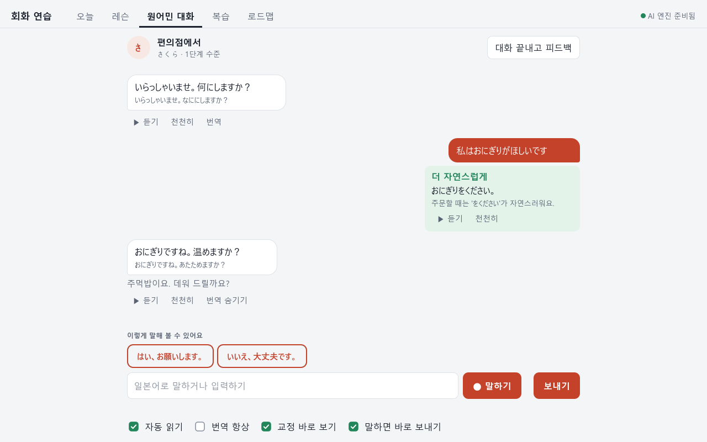
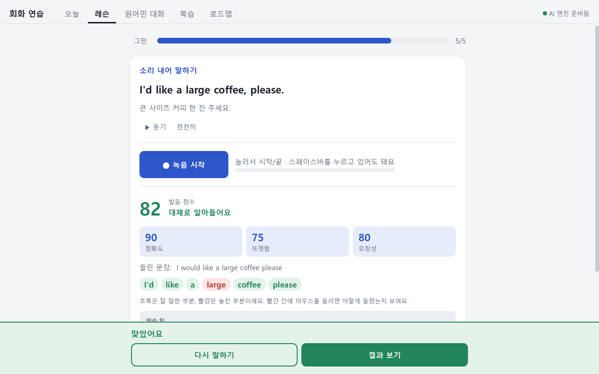

# 회화 연습 프로그램 (영어·일본어)

한국어 사용자를 위한 Windows용(안드로이드 폰에서도 PC에 연결해 사용 가능) 영어·일본어 말하기 연습 프로그램입니다. 1년 커리큘럼을 따라 매일 레슨을 풀고, AI 원어민과 대화하고, 내 발음을 녹음해 채점받습니다. 음성 인식·목소리·발음 채점은 내 PC 안에서 돌아가고 비용이 들지 않습니다.

- **다운로드:** https://github.com/Whahan/hoehwa-practice/releases/latest
- **저장소:** https://github.com/Whahan/hoehwa-practice

## 할 수 있는 것

| 기능 | 내용 |
|---|---|
| 오늘 | 12개월 커리큘럼에서 오늘이 몇 개월차 몇 주차인지, 이번 주 할 일, 연속 공부 일수 |
| 레슨 | 실제 예문(Tatoeba)으로 매번 새로 만드는 문제 10개: 고르기, 빈칸, 문장 조립, 듣기, 따라 말하기. 정답이 틀릴 일이 없고 바로 만들어집니다. AI 레슨도 선택 가능 |
| 원어민 대화 | 카페 점원, 편의점 직원 같은 역할을 맡은 AI와 말로 대화. 틀린 문장은 몇 초 뒤 초록색 상자로 고쳐 주고, 끝나면 피드백 |
| 발음 채점 | 녹음한 내 목소리를 정확도·또렷함·유창성으로 채점. 영어는 억양 그래프(원어민과 내 높낮이 비교)와 소리 단위(음소) 교정까지 |
| 읽기 | 글을 붙여 넣으면 어려운 단어를 색으로 표시. 누르면 뜻·발음·실제 예문, 복습 목록에 바로 추가 |
| 복습 | 잊어버릴 때쯤 다시 나오는 간격 반복(FSRS). 레슨에서 틀린 문장, 대화에서 고친 문장(자동으로 카드가 됩니다), 읽기에서 모은 단어가 쌓입니다 |
| 연습: 미션 | 카페 주문, 호텔 체크인, 길 묻기, 면접 같은 상황 미션 8개(영어). AI 상대와 대화하며 목표를 하나씩 채우고 별을 받습니다. 목표 확인은 규칙으로 바로 하고, 놓친 목표만 AI에게 한 번 더 물어볼 수 있습니다 |
| 연습: 쉐도잉 | 문장을 들려주고 따라 말하면 단어별로 채점합니다(영어·일본어). 같은 문장을 반복하거나 다음 문장으로 넘어갑니다 |
| 연습: 받아쓰기 | 문장을 듣고 쓰면 틀린 단어를 표시합니다(영어) |
| 연습: 약한 소리 | 발음 채점이 쌓은 기록에서 자주 틀리는 소리(예: th, r/l)를 찾아 낱말 쌍·짧은 문장으로 집중 연습합니다(영어) |
| 기록 | 하루 공부 목표(기본 10분)와 달성 표시, 연속 공부 기록(하루 빠져도 보호권으로 이어 줌), 공부 시간·레슨 정답률·발음 점수 추이 그래프 |
| 로드맵 | 12개월 커리큘럼과 월별 체크리스트 |

## 필요한 것

- Windows 10/11 64비트, 저장 공간 약 15~20GB
- 마이크
- 인터넷: 설치할 때, 그리고 기본 AI 엔진(DeepSeek 무료)을 쓸 때
- NVIDIA 그래픽카드: 없어도 되지만 있으면 음성 인식이 빠릅니다. 오프라인 로컬 AI를 고르면 권장

## 설치/업데이트

**처음 설치 (한 번만)**

1. https://github.com/Whahan/hoehwa-practice/releases/latest 에서 `hoehwa-practice-setup-<버전>.zip`을 받습니다.
2. zip을 "모두 압축 풀기" 합니다. 폴더 경로는 짧게 해 주세요(예: `C:\회화 연습`). 한글이나 띄어쓰기는 괜찮습니다.
3. 풀린 폴더의 `설치.bat`을 더블클릭합니다. AI 엔진을 둘 중에서 고르면 나머지는 자동으로 설치됩니다(인터넷 필요, 20~60분).
   - **1) DeepSeek V4.1 Flash 무료 (기본, 추천):** Node.js(없으면 설치 여부를 물어봅니다)와 OpenCode를 설치하고, `opencode auth login`이 열리면 **본인의 OpenCode 계정**으로 로그인합니다. 로그인은 OpenCode가 직접 처리하고 설치 프로그램은 계정 정보를 보거나 저장하지 않습니다. 이 경우 Ollama는 설치하지 않습니다. 무료 제공 여부는 OpenCode 쪽 사정에 따라 달라질 수 있고, 로컬 AI도 설치해 두었다면 쓸 수 없을 때 프로그램이 자동으로 로컬 AI로 답합니다.
   - **2) 오프라인 로컬 (qwen3:8b, 약 5GB, NVIDIA 그래픽카드 권장):** Ollama와 모델을 받아 인터넷 없이 동작합니다.
   - 자동 실행: `설치.bat -Engine deepseek` 또는 `-Engine local`
   - `-Yes` 로 설치하면 엔진은 DeepSeek 무료가 기본이고, `opencode auth login` 로그인은 나중에 해도 됩니다.
   - 설치.bat을 다시 실행해도 이전에 고른 엔진(앱 안에서 바꾼 엔진 포함)은 그대로 유지됩니다. 엔진을 바꾸려면 `-Engine`으로 직접 지정하거나 번호를 고르세요.
   - 문법 검사기(LanguageTool)용 Java 17 이상이 없으면 Temurin 21 JRE(약 50MB)를 앱 폴더 안에 설치할지 물어봅니다. 거절해도 되고, 그러면 문법 교정은 AI가 합니다.
   - 중간에 끊겨도 `설치.bat`을 다시 실행하면 이어서 합니다.
4. 설치가 끝나면 `회화연습.exe`(또는 바탕화면 바로가기)로 실행합니다.

**업데이트**

- 프로그램 폴더의 `업데이트.bat`을 더블클릭합니다. GitHub의 최신 릴리스와 비교해서 새 버전이 있으면 받아서 적용하고, 최신이면 "최신 버전입니다"라고 알려 줍니다.
- 바뀐 파일만 바꾸고, 파이썬 패키지·음성 모델도 바뀐 것만 받습니다. 학습 기록, 설정, AI 엔진 선택, API 키는 그대로 남습니다.
- 바꾸기 전 파일은 `backup\<이전 버전>\`에 보관되고, 업데이트 중 문제가 생기면 자동으로 이전 버전으로 되돌립니다.
- 앱 폴더가 커지지 않게 정리합니다: 백업은 직전 것 하나만 남기고, 받은 업데이트 파일·임시 폴더는 성공/실패와 상관없이 바로 지우고, pip 캐시는 쓰지 않고, 새 버전에 필요 없어진 음성 모델 파일과 옛 로컬 AI 모델(Ollama)도 지웁니다. 끝에 `업데이트 전 X GB → 후 Y GB`를 보여 줍니다.
- 업데이트가 "새로 설치해야 합니다"라고 하면 위의 처음 설치를 다시 하면 됩니다(학습 기록은 남습니다).

릴리스 만들기(개발자): `packaging\publish_release.ps1 -Version 1.2.3 -Notes "바뀐 점"` — 설치 zip과 업데이트 zip, `SHA256SUMS.txt`를 만들어 GitHub 릴리스에 올립니다. 배포 저장소는 `packaging\release.json`에 있습니다.

내 PC에서 돌아가는 회화 연습 프로그램입니다. 비용이 들지 않습니다. 음성 인식·목소리·발음 채점·문법 검사는 인터넷 없이 동작하고, 대화·레슨 AI는 기본으로 무료 DeepSeek V4.1 Flash(OpenCode, 인터넷 필요)를 씁니다. 인터넷이 없거나 무료 모델의 한도에 걸리면 오프라인 로컬 AI(Ollama qwen3:8b)가 자동으로 대신 답합니다.

## 휴대폰에서 쓰기 (안드로이드)

같은 와이파이에 있는 안드로이드 폰에서 레슨·대화·읽기·복습·로드맵을 쓸 수 있습니다. 음성 인식·목소리·채점·AI는 여전히 **내 PC**가 하고, 폰은 화면과 마이크만 맡습니다. 그래서 PC 앱이 켜져 있어야 하고, PC와 폰이 같은 와이파이에 있어야 합니다. 폰 연결은 기본으로 꺼져 있고, 켜도 연결 코드를 입력한 폰만 쓸 수 있습니다. (PC 앱도 휴대폰 연결이 들어 있는 버전이어야 합니다. 폰 앱은 PC 앱과 같은 버전으로 나옵니다.)

**폰에 설치 (한 번만)**

1. 폰에서 https://github.com/Whahan/hoehwa-practice/releases/latest 를 열어 `hoehwa-practice-android-<버전>.apk` 를 받습니다.
2. 받은 파일을 열면 "출처를 알 수 없는 앱 설치"를 허용하라고 나옵니다. 사용 중인 브라우저(또는 파일 앱)에 대해 허용해 주세요. Google Play에 올린 앱이 아니라서 나오는 안내입니다.
3. Play Protect가 "안전하지 않은 앱" 경고를 띄우면 **무시하고 설치**(또는 "그래도 설치")를 고릅니다. 앱을 직접 서명했지만 Google이 모르는 개발자라서 나오는 경고입니다. 걱정되면 릴리스의 `SHA256SUMS.txt` 값과 받은 파일의 SHA-256이 같은지 확인하세요.
4. 처음 녹음할 때 마이크 권한을 묻습니다. "허용"을 누르세요. 거부했다면 폰 설정 > 앱 > 회화 연습 > 권한 > 마이크에서 켤 수 있습니다.

**PC와 연결**

1. PC에서 회화 연습을 켜고 **설정 > 휴대폰 연결**을 켭니다. 주소와 6자리 연결 코드가 나옵니다(코드는 5분 동안만, 한 번만 쓸 수 있고 5번 틀리면 잠깁니다).
2. 처음 켜면 Windows가 "이 앱이 네트워크에서 통신하도록 허용하시겠습니까?" 창을 띄웁니다. **개인 네트워크**를 체크하고 "액세스 허용"을 누르세요. 앱이 방화벽 설정을 직접 바꾸지는 않습니다.
3. 폰 앱에서 [PC 자동 찾기]를 누르거나 PC 화면의 주소(예: `192.168.0.12`)를 직접 입력하고, 연결 코드를 입력합니다. 한 번 연결하면 다음부터는 코드가 필요 없습니다.
4. 안 쓸 때는 PC의 설정에서 휴대폰 연결을 끄세요. 끄면 외부 연결 포트가 바로 닫힙니다. PC 설정에서 폰 연결을 개별 해제하거나 모두 해제할 수도 있습니다.

**밖에서 쓰기 (Tailscale, 선택)**

같은 와이파이가 아닌 곳(모바일 데이터, 다른 와이파이)에서도 쓰려면 Tailscale을 씁니다.

1. PC와 폰에 Tailscale 앱을 설치하고 **같은 계정**(예: 구글 계정)으로 로그인합니다.
2. PC 앱의 **설정 > 휴대폰 연결 > 고급**에서 **Tailscale 로 연결 허용**을 켭니다.
3. 폰 앱의 주소 칸에 PC 화면의 **Tailscale 주소**(`100.`으로 시작, 예: `100.101.102.103`)와 포트를 입력하고 연결 코드를 넣습니다.

Tailscale을 쓸 때는 [PC 자동 찾기]가 되지 않으니 주소를 직접 입력하세요. 같은 Tailscale 계정(테일넷)에 들어온 다른 기기도 이 PC의 연결 포트에 닿을 수 있습니다(연결 코드나 토큰이 있어야 쓸 수 있어요). 계정을 남과 공유하지 마세요.

**알아 둘 것**

- **카페·학교·호텔 같은 공용 와이파이에서는 켜지 마세요.** 폰과 PC 사이 통신은 암호화되지 않아서 같은 와이파이의 다른 사람이 볼 수 있습니다. 집이나 내가 관리하는 와이파이에서만 쓰세요. 공용·게스트 와이파이는 기기끼리 통신을 막는 경우도 많습니다.
- PC가 잠들거나 꺼지면 폰에서 쓸 수 없습니다.
- 학습 기록은 폰과 PC가 따로 갖습니다(동기화하지 않습니다).
- **업데이트:** 새 APK를 받아 그대로 설치하면 기존 앱 위에 덮어 설치됩니다(학습 기록이 남습니다). 덮어 설치가 되려면 같은 키로 서명된 APK여야 합니다. 아래 개발자 절의 키스토어 경고를 꼭 읽어 주세요.
- 폰에서 안 잡힐 때 점검: ① PC 앱의 '휴대폰 연결'이 켜져 있는지 ② 폰과 PC가 같은 와이파이인지 ③ Windows 방화벽 허용 창을 눌렀는지 ④ Windows 네트워크 프로필이 '개인'인지.

## 실행

`dist\회화연습.exe`를 더블클릭합니다.

- 처음 켜면 "AI 엔진 준비 중…" 화면이 나오고, 보통 15초~1분 정도 걸립니다. 음성 인식, 목소리, AI 모델을 불러오는 시간입니다.
- 프로그램을 닫으면 프로그램이 직접 켠 음성·AI 서버도 같이 꺼집니다.
- `dist` 폴더를 다른 곳으로 옮기지 마세요. exe는 바로 위 폴더의 `backend`를 찾아서 씁니다.

## 할 수 있는 것

| 화면 | 내용 |
|---|---|
| 오늘 | 커리큘럼상 오늘이 몇 개월차 몇 주차인지, 이번 주 할 일, 연속 공부 일수, XP |
| 레슨 | 이번 주 내용으로 AI가 문제 10개를 새로 만듭니다. 고르기, 빈칸, 문장 조립, 듣기, 따라 말하기 |
| 원어민 대화 | 마이크 버튼을 누르고 말하면 AI 원어민이 답하고 목소리로 읽어 줍니다. 틀린 문장은 몇 초 뒤 초록색 교정 상자로 고쳐 줍니다 |
| 복습 | 레슨에서 틀린 문장과 대화에서 교정받은 문장을 다시 말해 봅니다 |
| 연습 | 미션(역할극 목표 채우기, 영어), 쉐도잉(영어·일본어), 받아쓰기(영어), 약한 소리 집중 연습(영어). 위쪽 표 참고 |
| 기록 | 일일 목표, 연속 기록과 보호권, 공부 시간·정답률·발음 점수 그래프 |
| 로드맵 | 12개월 커리큘럼과 월별 체크리스트 |

화면 위쪽 탭이 8개(오늘 · 레슨 · 원어민 대화 · 연습 · 읽기 · 복습 · 기록 · 로드맵)이고, 창이 좁아 다 들어가지 않으면 나머지는 "더보기"에 들어갑니다. 폰에서는 아래 탭에 5개와 "더보기"가 나옵니다. 공부 시간은 창에 포커스가 있고 최근 45초 안에 입력(또는 녹음·재생·서버 요청)이 있을 때만 셉니다. 학습 기록은 `studylog.json`에 따로 저장되며 기존 진행 기록(progress.json)은 건드리지 않습니다.

### 발음 채점은 이렇게 합니다

녹음한 목소리를 음성 인식(Whisper)이 직접 듣고, 목표 문장과 단어(일본어는 음절) 단위로 비교합니다.

- **정확도:** 목표 단어를 맞게 말했는지
- **또렷함:** 음성 인식이 그 단어를 얼마나 확신하며 알아들었는지
- **유창성:** 말하는 속도와 중간에 끊긴 시간
- 틀린 부분은 빨간색으로 표시하고, 한국인이 자주 틀리는 패턴을 찾아 한 줄 조언을 줍니다. 예: r/l, f/p, 장음, 촉음 っ

원어민 교사처럼 입 모양까지 보는 채점은 아니지만, 원어민이 알아들을 수 있게 말했는지는 꽤 정확하게 잡아냅니다.

## 문제가 생기면

| 증상 | 해결 |
|---|---|
| "Ollama를 실행해 주세요" | 시작 메뉴에서 Ollama를 실행하세요. 보통은 윈도우 시작 시 자동으로 켜집니다 |
| 무료 DeepSeek를 쓸 수 없다고 나옴 | OpenCode가 필요합니다: `npm install -g opencode-ai` 후 터미널에서 `opencode auth login`. 그동안은 오프라인 로컬 AI가 답합니다. 설정 → AI 엔진에서 "오프라인 로컬"을 고를 수도 있습니다 |
| 녹음이 조용하다고 나옴 | 윈도우 설정 → 개인 정보 → 마이크 → "데스크톱 앱이 마이크에 액세스하도록 허용"을 켜고, 프로그램 설정에서 마이크 장치를 고르세요 |
| 마이크를 열지 못했다고 나옴 | 녹음은 파이썬 서버(`pythonw`)가 맡습니다. 다른 프로그램이 마이크를 독점하고 있지 않은지 확인하고, 설정에서 다른 마이크를 골라 보세요 |
| AI 답이 이상함 | 오프라인 로컬 AI는 내 PC에서 돌리는 8B 크기 AI라서 가끔 어색하거나 틀린 문제가 나옵니다. 레슨은 정답을 한 번 더 검사해서 틀린 문제를 걸러 내지만, 완벽하지는 않습니다 |
| 서버만 따로 켜고 싶음 | `backend\run_backend.bat` (끄기: `backend\stop_backend.bat`) |

## 구성

| 폴더 | 내용 |
|---|---|
| `godot\` | 화면(Godot 4.6.3 프로젝트). 편집기에서 열고 F5로 실행할 수 있습니다 |
| `backend\` | 파이썬 로컬 서버: 음성 인식 Whisper small(GPU), 목소리 Kokoro(영어 af_heart, 일본어 jf_alpha), 발음 채점, 문법 검사(LanguageTool, `backend\tools`), AI 대화(기본: 무료 DeepSeek V4.1 Flash via `opencode serve` / 오프라인: Ollama qwen3:8b) |
| `dist\` | 내보낸 exe |
| `API.md` | 화면과 서버 사이의 API 규칙 |

다시 설치하려면 PowerShell에서 `backend\setup.ps1`을 실행합니다.

## 개발자: 안드로이드 APK 만들기와 서명

- 필요한 것: Godot 4.6.3 안드로이드 export 템플릿(Godot 편집기 > 편집기 > 내보내기 템플릿 관리), JDK 17, Android SDK(platform-tools, build-tools 36.1.0, platforms android-36). 편집기 설정 > 내보내기 > Android 에 SDK·JDK 경로가 한 번 들어 있어야 합니다. Gradle·Android Studio는 필요 없습니다.
- **릴리스 키 만들기(딱 한 번):** `packaging\make_release_key.ps1` 은 `%LOCALAPPDATA%\hoehwa-practice\keys\` 에 `release.keystore` 와 무작위 비밀번호 파일 `release.pass` 를 만들고(이미 있으면 거부, 덮어쓰지 않습니다), 인증서 지문을 `packaging\android_cert.sha256` 에 적습니다. 그 지문 파일만 커밋하세요. 키 파일은 저장소 밖에만 두고, 저장소 안에 두면 빌드가 거부합니다.
- **빌드:** `packaging\build_android.ps1 -Version 1.1.0` 은 `godot\project.godot`·export preset의 버전과 맞는지 확인한 뒤 서명된 `packaging\out\android\hoehwa-practice-android-<버전>.apk` 를 만들고, 서명·패키지 이름(`io.github.whahan.hoehwa`)·versionCode·권한(INTERNET, ACCESS_NETWORK_STATE, RECORD_AUDIO뿐)·arm64-v8a만 들었는지 검사합니다. `-Debug` 는 시험 설치용 디버그 서명 APK(올리면 안 됩니다)입니다. 키스토어 비밀번호는 환경변수로 Godot 자식 프로세스에만 전달되며 `export_presets.cfg` 에는 쓰지 않습니다.
- **릴리스:** `packaging\publish_release.ps1 -Version 1.1.0 -WithApk -Notes "바뀐 점"` 은 설치 zip·업데이트 zip과 함께 APK를 `SHA256SUMS.txt` 에 넣어 올립니다. APK 서명 인증서가 `android_cert.sha256` 과 다르면 멈춥니다(`-AcceptNewKey` 로만 넘어갈 수 있고, 그러면 기존 사용자는 덮어 설치가 안 됩니다). 공개 전 검사(`-ScanOnly`)는 `.keystore` `.jks` `.p12` `.apk` `release.pass`, 키스토어 비밀번호가 적힌 줄이 추적되고 있으면 멈춥니다.
- **경고 — 키스토어를 잃어버리지 마세요.** 이 키스토어를 잃어버리거나 비밀번호를 잊으면 같은 앱을 덮어 설치할 수 없습니다. 사용자는 앱을 지우고 다시 설치해야 하고, 그러면 폰에 있던 학습 기록이 사라집니다. `keys` 폴더 전체를 서로 다른 두 곳(예: USB와 암호 관리자)에 백업하세요. 저장소에 올리지 마세요.

## 사용한 공개 자료와 라이선스

이 프로그램은 다음 공개 프로젝트와 자료를 사용합니다. 각 라이선스를 따릅니다.

| 이름 | 쓰는 곳 | 라이선스 |
|---|---|---|
| [Tatoeba](https://tatoeba.org) 예문 | 레슨·읽기 예문 | CC BY 2.0 FR (예문 화면에 출처 표시) |
| [Godot Engine](https://godotengine.org) | 화면 | MIT |
| [faster-whisper](https://github.com/SYSTRAN/faster-whisper) / Whisper | 음성 인식 | MIT |
| [Kokoro-82M](https://huggingface.co/hexgrad/Kokoro-82M) | 원어민 목소리 | Apache 2.0 |
| [wav2vec2 espeak](https://huggingface.co/facebook/wav2vec2-lv-60-espeak-cv-ft) | 음소 발음 채점 | Apache 2.0 |
| [LanguageTool](https://languagetool.org) | 문법 교정 (설치 때 내려받음) | LGPL 2.1 |
| [py-fsrs](https://github.com/open-spaced-repetition/py-fsrs) | 복습 주기 알고리즘 (GDScript로 옮김) | MIT |
| [pyopenjtalk](https://github.com/r9y9/pyopenjtalk), [spaCy](https://spacy.io), [wordfreq](https://github.com/rspeer/wordfreq) | 일본어 읽기, 단어 원형, 단어 빈도 | 각 프로젝트 라이선스 |
| [Ollama](https://ollama.com) + Qwen3 8B | 오프라인 로컬 AI | MIT / Apache 2.0 |
| [OpenCode](https://opencode.ai) (DeepSeek V4.1 Flash 무료) | 기본 AI 엔진 (각 사용자 본인 계정) | OpenCode 이용약관 |

## 라이선스

이 프로그램의 코드는 [MIT 라이선스](LICENSE)입니다. 위 표의 공개 자료와 프로그램은 각자의 라이선스를 따릅니다.
